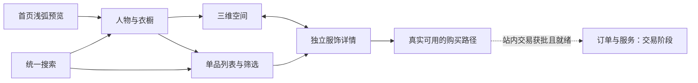

# Star Closet 产品需求文档

**静态发布补充（2026-10-15）**：用户已要求分别提供线上预览，因此本轮Slides与设计材料的静态发布已获授权；文中应用开发、真实交易与应用部署的限制继续适用。发布完成须以实际可访问的URL核验为准。

版本：0.2 · 补交评审稿 · 2026-10-15（Asia/Singapore）。

本文是完整平台的产品方案，不是全部功能已批准进入首版的承诺。产品文档、静态设计与HTML Slides已获授权；网站应用开发、真实支付及部署仍未授权。已确认要求见[决策记录](决策记录.md)，状态和补交事实见[交付记录](交付记录.md)。

## 1. 定位与目标

以人物审美、艺术化衣橱和真实可旋转服饰，连接灵感发现、商品理解与选购。既服务“想看看某个人的风格”，也服务“直接找某品牌、品类或风格”。

产品目标：
- 用户能找到相关人物、衣橱与单品，不必先加载3D。
- 用户能通过真实三维观察与可信资料理解服饰，准确辨别原件、同款、推荐或相似款。
- 在供给、支付及责任真实具备后，提供连续购买与统一服务。

目标市场、首批人物、具体用户优先级和商品类型待决定；没有用户量、营收或转化提升的实证结论。

## 2. 用户与核心旅程

| 用户情境 | 完整路径 | 成功标准 |
| --- | --- | --- |
| 灵感浏览 | 首页轮播→人物与风格→衣橱→服饰 | 发现并理解一个单品 |
| 找某个人 | 姓名/别名搜索→人物/衣橱→相关单品 | 正确身份，不混同名 |
| 风格/标签发现 | 搜索或点标签→过滤→详情 | 结果符合条件且可解释 |
| 品牌/品类需求 | 搜索→规格与条件筛选→详情 | 快速判断候选商品 |
| 分享直达 | 独立单品链接→详情→来源衣橱 | 不需重走首页 |
| 购买与购后 | 规格→准确购买路径→订单/服务 | 费用、责任和状态可信 |

详情、搜索、普通列表支持手机竖屏；进入3D时提醒横握。是否强制横屏仍待决定，建议保留可用替代路径。

## 3. 产品信息架构

首页、衣橱目录、单品目录、全局搜索、衣橱介绍/3D/列表、独立详情构成核心内容层；购物袋、结算、订单与服务按交易阶段开放。账号、收藏与社区不自动纳入首版。

详细页面、路由语义、导航与搜索规则见[信息架构与搜索](信息架构与搜索.md)。

## 4. 功能要求与验收

| 模块 | 已确认目标 / 建议细节 | 验收重点 |
| --- | --- | --- |
| F01 首页 | 浅弧轮播，中央最大正对、侧卡部分露出；头像姓名风格介绍和进入按钮 | 切换后信息与目标一致；手机可滑可点 |
| F02 导航 | 完整的衣橱、单品与全局搜索入口；具体结构为建议 | 普通任务不依赖3D；返回恢复位置 |
| F03 搜索 | 覆盖人物、风格、标签、品牌、品类；实体分组和筛选为建议 | 别名合并、组合条件、空结果与错误有不同路径 |
| F04 衣橱 | 电影式镜头；选中射灯中央舞台与右侧玻璃卡 | 模型、灯光、信息同一商品；返回不迷失 |
| F05 详情 | 核心服饰真实立体可旋转；完整商品决策资料 | 侧背面、变体表示范围、来源与可售状态清楚 |
| F06 购买 | 站内购买与后台供给为重点评估，未选商业模式 | 最终报价、库存、支付、履约和售后必须可执行 |
| F07 订单 | 交易阶段建议统一查询与服务 | 订单、支付、包裹、售后与退款分别准确 |
| F08 运营 | 建议受控目录、素材、发布、供给与异常流程 | 未发布不泄露；资料/模型/报价可追溯 |
| F09 质量 | 建议加载恢复、图文回退、分享、键盘读屏和减弱动态 | 失败仍有出口；回退不伪称3D达标 |

逐项清单见[功能清单](功能清单.md)，实现与替代见[实现架构与功能映射](实现架构与功能映射.md)。

### F01 首页细节

衣橱画面是主视觉，信息区在预览下方；玻璃主要用于外框与信息底座，文字不模糊。投影、透视、远近、遮挡和边缘高光共同营造深度。

建议不自动轮播；侧卡点击先选中，进入操作到达当前衣橱。只有一间内容时不伪造多个可进入空间。眼平房间与微缩剖切构图仍是候选，见[设计探索](design/设计探索.md)。

### F03 搜索细节

仅索引已发布、可展示的内容。建议人物/衣橱与单品分组，同维度多选OR、跨维度AND，条件显式可移除。纠错给建议，不能静默改词或丢掉条件。数据条件满足后才开放价格和库存过滤。

### F04–F05 三维与详情

所有纳入核心三维选中与旋转体验的服饰都必须有完整真实模型；待定的是入选范围与数量。图片回退或额外图文目录不能算核心三维目标完成。

服饰旋转需可观察真实侧背面；模型不自动证明试穿适配、尺寸准确或明星归属。颜色/尺码对应不完整时必须说明。建议中性检视资料辅助判断舞台灯光下的色差。

详情至少考虑名称品牌、品类、材质结构、尺码版型、护理、成色缺陷、人物关系与证据、资产表示范围、可售状态、价格币种与时间、卖方、配送、费用、退换和客服。必填条件按是否展示或可售分层，见[服饰详情与3D体验](服饰详情与3D体验.md)。

### F06–F07 交易边界

前台统一体验不等于隐去销售和履约责任。本人原件/唯一库存、同款新品SKU、相似款分别管理。外链导购、授权多商家、平台销售主体三种模式要比较，不能以抓取商品页替代供货和收款授权。

真实交易需最终费用、可售校验、付款幂等、供应接单、物流、取消、退换、退款、客服和对账。建议先单市场单币种单供应商，再扩跨商家分单。比赛演示必须明确不收款、不产生真实订单，见[交易与履约方案](交易与履约方案.md)。

## 5. 数据与状态

| 实体 | 独立管理的原因 |
| --- | --- |
| 人物/别名/衣橱 | 正确检索、关系证据与空间主题 |
| 商品/变体/实物件 | 款式、颜色尺码与唯一二手件不可混同 |
| 资产版本 | 来源、完整度、代表规格与精度限制 |
| 供给报价 | 卖方、履约、价格币种、库存时间和地区 |
| 订单/付款/包裹/售后/退款 | 不同状态生命周期及异常恢复 |

搜索、三维、详情和购物袋引用一致商品身份。预览、模型与报价各有状态；模型不是库存，展示不是销售授权。

## 6. 设备、非功能与指标

- 响应式覆盖桌面和手机；进入前的横屏提醒与旋转后的状态保持需实测。
- 普通资料先可读，场景按需加载；首屏不同时加载全部衣橱。
- 键盘、读屏、减弱动态、对比度与可触控区域纳入验收。
- 加载时间、帧率、体积、最低设备/网络与目标值尚未批准，不编造达标结果。
- 观察搜索无结果率、有效详情到达、三维操作成功、理解正确率、购买意向和真实交易成功。外链点击不是成交。
- 分析事件只记录必要行为，订单私密信息不能混入公共目录或普通埋点。

## 7. 分期与比赛建议

1. **文档与供给收敛**：当前允许执行，补全策略、资产来源、交易责任及验收。
2. **体验验证**：获编码授权后，建议一间可进入衣橱、一件主服饰真GLB、少量有来源目录、浅弧入口、简搜、聚光旋转、右卡与手机路径。
3. **真实交易试点**：合同与供应/支付就绪后，单供应商完整闭环，包含退款与对账。
4. **规模化**：多供应商、更多人物内容及更复杂运营。

2026-10-15 08:00的Slides交付未完成。原08:00→周六12:00为52小时窗口；当前应按实际补交时间重排，不能把自然时间当每人的连续工时。当前应用实现没有可核验完成结果。实际计划和角色见[两天冲刺与团队](两天冲刺与团队.md)。

## 8. 待执行验收场景

1. 手机横滑与上下滚动不冲突，人物与进入目标一致。
2. 姓名/别名、品牌+品类、风格标签查询可解释；空结果和请求失败区分。
3. 分享单品直达，返回恢复条件和位置。
4. 选中对象、聚光、模型与玻璃卡一致，能看真实侧背面。
5. 横竖屏、减弱动态、模型失败、无WebGL均有真实可用路径。
6. 商品原件/同款/相似款、模型规格和可售状态准确。
7. 真实交易的改价缺货、重复付款、拒单、部分发货退款均可恢复。
8. 未发布/撤回内容不继续出现在公开搜索或新成交中。

这些是拟定验收，不是功能测试通过记录。HTML文档检查和实际浏览器检查另见交付记录。

## 9. 决策优先级

首批用户与市场→卖原件/同款/相似款→人物资料/资产/供货→首个体验与目标设备→交易责任→技术路线与团队→应用编码授权。先解决真模型和Web3D人员，避免把两天窗口用于不确定的全平台工程。
