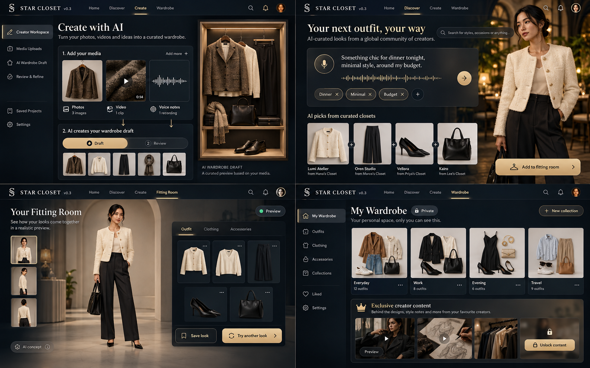

# Star Closet · 静态设计预览 v0.3

2026-10-15 更新。平台方向由明星衣橱扩展为主理人、品牌与主题的公共策展，并连接 Agent 建橱、个人搭配和本人化身试穿。
当前是设计文档与静态评审画廊，没有运行上传、录音、Agent、试穿、登录或支付。

[设计画廊线上入口](https://wilsonwang-mt.github.io/star-closet/design/preview.html) · [Slides 线上入口](https://wilsonwang-mt.github.io/star-closet/presentation/star-closet-hackathon.html)

入口沿用既有静态发布地址；v0.3 修改需随本轮发布同步，具体可见版本以实际线上结果为准。

## 本轮新增的设计表达

- **五类公共发现入口**：明星、网红／穿搭博主、品牌主题、风格主题、审核个人；入口可交叉，公共衣橱不必对应真实实体房间。
- **创作者／团队流程**：照片／视频／语音 → Agent 整理草稿 → 编辑核对 → 审核发布；不把图片解析当成完整真实三维资产。
- **大众流程**：语音／文字诉求 → 服装与配饰搭配 → 个人试衣间 → 本人化身一键试穿；效果与准确性尚未验证。
- **访问层级**：公共策展、粉丝门票解锁内容、仅本人可见的付费个人私密衣橱分开表达；私密空间不提供邀请、团队访问或分享，点赞收藏不改变访问权限。

[双流程静态图解](preview.html#journeys) · [三种访问语义](preview.html#access) · [完整设计规范](设计探索.md)

## v0.3 平台概念图

- 左上：照片／视频／语音与 Agent 草稿审核；不是实际上传、解析或发布。
- 右上：诉求、服装配饰组合和加入试衣间；人物、品牌、来源与商品均为虚构示例。
- 左下：本人化身试穿目标；多角度人像不证明精确重建、真实 3D、商品模型对应或合身。
- 右下：仅本人衣橱与独立门票内容入口；个人订阅或容量权益不自动包含门票，私密空间不提供邀请、团队访问或分享，私域数据不向创作者开放。

[打开新概念整图](concepts/platform-v03-atlas-20261015.png) · [四象限大视图](preview.html#views)

图中数量、状态、服饰与人像均为静态生成示例，实际需求与能力说明优先，不是已完成应用。

## 保留的早先视觉基线

原 atlas PNG 未改动；它只用于浅弧、暗色玻璃、空间光影、聚光服饰与手机构图的视觉基线。
它没有完整入驻、Agent、试衣间、本人化身和付费权益设计，不是 v0.3 最新完整效果图。

- 左上：浅弧衣橱预览，中央最大，两侧部分露出，保留主体信息与入口。
- 右上：单品中央聚光与右侧玻璃卡；核心服饰真实立体可旋转仍是产品目标，图像不能证明达标。
- 左下：搜索气氛参考；生成图存在筛选与结果错配，不是准确搜索结果。
- 右下：手机竖横屏构图；侧邻卡与横屏提醒未充分体现，文字规范优先。

人物、品牌、商品和房间均作虚构示意；不暗示合作、实体衣物归属或真实商品事实。

[素材来源与边界](素材清单.md) · [v0.3 PNG](concepts/platform-v03-atlas-20261015.png) · [v0.2 基线 PNG](concepts/visual-atlas-20261015.png) · [HTML 画廊文件](preview.html) · [Slides PDF](../presentation/star-closet-hackathon.pdf)

HTML 画廊支持随目录离线打开；GitHub 源码页不等于可访问预览。PDF 是否覆盖 v0.3 需以演示文档的实际更新与导出状态为准。
