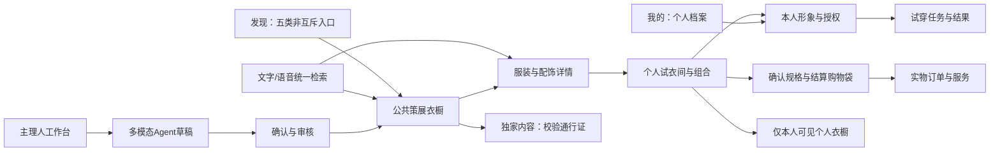

# Star Closet 产品需求文档

版本：v0.3 · 定位调整完整评审稿 · 2026-10-15（Asia/Shanghai，UTC+8，与新加坡同一时刻）。

本版依据用户与时尚顾问讨论后的最新要求，替代v0.2冲突内容。完整产品需求已扩大；首版范围、费用、商业合同、技术栈和能力指标仍待确定。产品文档、静态演示、提交合并及静态预览已有授权，网站应用尚未开发。依据见[决策记录](决策记录.md)，变更见[定位调整与需求追踪](定位调整与需求追踪.md)。

**2026-10-16 补充**：用户新增“登录后建立完整个人档案”与“上传多张照片、AI 协助生成完整精准、高还原度的本人 3D 形象”（D45、D46），个人影像存储规则见 D47。本版在旅程、模块表和数据实体中加入 F18 个人档案与 F12 多照片 3D 形象子项；比赛版应用开发已在 `app/` 获授权（D34、D44），高还原度仍是目标，未经验证。

## 1. 产品定位

**一个由主理人和品牌策展、由AI帮助建橱与搭配的大众时尚平台：发现喜欢的审美，把服装和配饰带进个人试衣间，以自己的形象查看搭配，再完成可信选购。**

“明星衣橱 / Star Closet”暂作工作名称；不再将品牌语义、用户资格和场景限定在明星或明星实体住宅。衣橱可以是授权实物内容、品牌主题、秀场系列或风格策展；必须说明呈现性质，不能把编辑策展伪装成真实私宅或本人原物。

### 1.1 用户价值

- 大众消费者：从“我想像谁一样穿”或“我明天需要穿什么”到可理解、可修改的搭配；不用先认识某个明星。
- 创作者与团队：降低内容组织和空间制作成本，将穿搭影响力变成可追踪的商品或数字内容收入。
- 品牌与供应商：用主题陈列与可信商品资料帮助消费者理解系列，取得可核验的销售或服务收益。
- 平台：复用目录、资产、试穿能力与履约连接；长期收益取决于复访、净成交和单位成本，不取决于衣橱数量本身。

首批客群、市场与币种未定。用户已说明有时尚穿搭博主/时尚顾问组队，可参与审美和搭配验收；不推定已有供给、版权或明星合作。

### 1.2 五类公共入口

| 入口 | 创建与内容示例 | 必须表达 |
| --- | --- | --- |
| 明星衣橱 | 明星及授权团队的穿搭/内容 | 原物、推荐、策展或合作关系的真实证据 |
| 网红/穿搭博主 | 主理人及团队的精选与搭配 | 主理身份、商业关系及商品对应 |
| 品牌主题 | 某系列、秀场、季节或联名主题 | 品牌关系、系列归属与展示/销售范围 |
| 风格主题 | 休闲、老钱、运动等场景策展 | 策展者、风格标签与推荐依据 |
| 个人主理人 | 对穿搭有研究的个人申请 | 审核通过才公开；与本人私密衣橱分开 |

这是可叠加的发现入口，不是互斥账户类型。底层主体为个人/组织，团队角色、品牌关系、主题、风格和可见性分别记录。同一衣橱可同时属于博主、品牌联名和运动主题，按稳定ID去重。用户举的“山本耀司2026秀场”仅为意向例子，不是已获授权或核实的供给案例。

### 1.3 愿景与体验目标（建议稿）

[愿景与用户体验目标](愿景与用户体验目标.md)建议以“让每个人都能找到自己的风格，自信地表达自己”为长期方向，配合消费者五项体验目标和主理人创作目标。该表述尚未由用户确认，不增加本PRD已确认需求、试穿精度承诺或首版范围。

## 2. 产品对象与术语

| 对象 | 作用 | 不可混同 |
| --- | --- | --- |
| 公共策展衣橱 | 可发现、可浏览的主理人/主题空间 | 不必是真实实体衣橱复刻 |
| 专属付费内容 | 明确预告与权益的独家子空间/内容 | 不含私人地址、人体资料或其他非授权隐私 |
| 点赞 | 对内容表达偏好 | 不等于收藏、持有、下单或付费 |
| 收藏 | 保存喜爱的内容或单品引用 | 不等于本人拥有这些衣物 |
| 个人试衣间 | 跨衣橱收集待试单品、组合及试穿结果 | 是购物车体验的延伸，不代表锁库或成交 |
| 结算购物袋 | 已确认变体与数量、待最终报价的商品 | 不能用未选尺码的试衣间条目直接付款 |
| 私密个人衣橱 | 付费获得的持久化个人整理与空间体验 | 仅本人可见；不自动变成公共主理人主页 |
| 个人档案 | 登录用户的昵称、风格、尺码、预算等资料；身高体重需单独同意 | 仅本人可见，不是公开主页或创作者资料（D45） |
| 个人形象/化身 | 经授权生成的本人表示与版本；多照片 3D 形象是其中一种（D46） | 与公开创作者头像、商品模型和尺寸保证不同 |
| 交易/数字权益 | 实物订单、内容通行证、私密服务订阅等 | 物理配送、数字访问和会员状态分别管理 |

私密衣橱可组织心愿单品；若后续支持“已购/自有”标记，需用户或订单事实明确，不由收藏自动推断。具体免费容量、触发阈值、订阅周期与到期政策待定。

## 3. 角色与权限

| 角色 | 可完成的任务 | 权限边界 |
| --- | --- | --- |
| 访客 | 公共浏览、文字搜索、查看可公开详情 | 不要求上传人体照片；不能读取他人私域 |
| 消费者 | 点赞收藏、试衣间、个人形象与试穿、购买权益/商品 | 数据归本人；付费不代表公开或训练授权 |
| 主理人/品牌所有者 | 申请入驻、建橱、成员管理、方案选择 | 入驻认证与内容审核独立，缴费不绕审核 |
| 团队编辑 | 在被分配空间上传、修订草稿与搭配 | 按空间/操作授权，不自动接触粉丝化身 |
| 发布/财务成员 | 审批发布或查看结算 | 发布权与财务权可分开，敏感操作有记录 |
| 平台审核/客服/财务 | 内容治理、异常服务、支付退款与结算 | 最小权限；不得因运营角色任意看用户人体资料 |
| AI Agent | 在任务授权内提取、推荐、生成草稿 | 不代替来源、支付、权限、审核或供给确认 |

公共个人主理人需用户主动申请并审核；不会因收藏超阈值或购买个人衣橱就自动公开其数据。私密化身默认不向创作者、品牌、其他消费者开放。

## 4. 完整用户旅程

### 4.1 创作者及团队建橱

申请与主体确认 → 团队分工 → 照片/视频/语音上传 → Agent识别并结构化 → 衣橱/单品/搭配草稿 → 主理人纠正 → 补SKU、来源和资产 → 内容/关系/质量审核 → 设置免费或付费权益 → 发布版本 → 内容与供给持续更新。

Agent应把“已识别、推断、缺失”分开，关键字段回链原始资料；不从一段视频编造品牌、价格、物主、背面或可售库存。图片可先形成草稿；核心3D服饰仍需完整模型验证。详见[入驻与Agent建橱](入驻与Agent建橱.md)。

### 4.2 普通用户选搭配与试穿

（可选）登录并完善个人档案，风格、尺码与预算可作为推荐默认约束 → 公共发现或说出需求 → 确认识别出的场景、风格、预算和限制 → AI选择服装与配饰组合 → 加入个人试衣间并可撤销/替换 → 选择试穿 → 按能力要求上传本人资料并授权 → 生成/确认个人形象版本 → 一键试穿与对比 → 确认商品规格和最终费用 → 真实可用购买路径。

例：“周五晚宴，整体简洁，预算以内，外套加鞋包，排除皮革。”系统应说明预算是否包含全部搭配、税运与配饰；缺货、不兼容或信息不全时不能默默超预算或替换成另一商品。

允许用户按明确意图批量加入试衣间，必须展示加入结果并可撤销；购买、开通付费衣橱、付费试穿或门票仍需单独确认。精确交互和默认是否自动加入属于设计建议，不是默认授权消费。

### 4.2.1 个人档案与多照片 3D 形象（D45、D46）

登录 → 进入“我的档案”填写昵称、风格、喜欢的颜色、尺码、预算、城市 → 身高体重单独勾选同意后才保存，可一键清空 → 进入“我的 3D 形象” → 阅读拍摄要求与用途说明 → 按引导上传正面、侧面、背面全身照（可加面部近照） → 系统检查格式、数量与明显问题，提示补拍 → 用户确认发起生成；若要发给第三方服务，需单独勾选同意该服务 → 异步作业：排队、处理中、成功或失败 → 在查看器里 360° 旋转查看，结果标明生成方式与“不代表精确本人或尺寸” → 可删除单张照片、单个形象或全部删除。

没有接入生成服务的 key 或用户未同意第三方发送时，只显示标注“非本人示意模型”的通用人形，不冒充生成结果。照片、身体数据和形象仅本人可见，不进入公共检索、创作者后台或训练。“还原度非常高”是用户目标；比赛版对外写成“可 360° 旋转的 3D 形象预览（还原外观轮廓，不代表精确本人或尺寸）”，精度按[AI试穿与个人形象](AI试穿与个人形象.md) §5 闸门分级验收，路线见该文 §12。

### 4.3 私密个人衣橱

点赞/收藏 → 试衣间搭配 → 达到尚未确定的数量条件 → 清楚解释免费能力与付费增益 → 选择方案与确认付款 → 开通仅本人可见的整理空间 → 管理、导出、续费/取消。

建议收费价值放在持久搭配、空间整理和明确的计算服务，不因触发阈值追溯锁住已有收藏。到期保留范围、只读与导出期限需在购买前说明；不可将支付与数据删除权绑定。

### 4.4 粉丝内容解锁

公共预览与权益说明 → 验证内容、价格和可访问期限 → 确认购买 → 服务端发放通行证 → 访问获准版本 → 到期、退款或撤回后的明确处理。

“支持喜欢的主理人”是动机；带来访问权益的付款按数字内容服务设计，不能只标“打赏”而忽略交付、退款、分成和渠道收费规则。公共发现保留免费价值，不默认给全部衣橱设门槛。

2026-10-15 用户新增不解锁内容的虚拟礼物打赏（D42），与本节门票并列为两条粉丝线，关系待确认；另有链接导入、场景姿态试穿、多选下单与入驻两档收费，见[产品方案与分阶段计划](产品方案与分阶段计划.md)。

## 5. 信息架构与导航

建议主导航为发现、搜索、个人试衣间、我的；主理人工作台按角色出现，不挤入普通消费者所有主导航。常规搜索、详情、管理保持手机竖屏可读；进入空间前提醒横握，是否强制仍待定。详细路由与实体见[信息架构与搜索](信息架构与搜索.md)。

## 6. 功能模块与验收总览

| 模块 | v0.3要求 | 核心验收 |
| --- | --- | --- |
| F01 首页 | 浅弧主卡保留，扩展主理人/品牌/主题信息与五类发现 | 卡片、身份、主题、权限与进入目标一致 |
| F02 导航 | 公共发现、个人空间、工作台与购买路径清楚 | 角色切换不丢归属；无需进入3D才能完成普通任务 |
| F03 搜索 | 人物/主理人、风格、标签、品牌、品类，加文字/语音意图 | 识别可纠正；受限内容不经结果、摘要或AI检索泄露 |
| F04 衣橱舞台 | 电影式镜头、聚光、右侧玻璃卡和返回 | 真实模型、被选商品与信息一致，失败有出口 |
| F05 商品详情 | 服装及配饰资料、来源、可售规格、模型/试穿能力 | 原件/同款/相似、代表规格与可用能力不混淆 |
| F06 实物购买 | 试衣间到变体确认、最终报价、付款和履约 | 加入试衣间不锁库、不自动买，报价变化需确认 |
| F07 订单服务 | 实物订单、物流、取消退货与退款 | 部分退款、拒单与库存异常可追踪 |
| F08 运营治理 | 主体、内容、供给、素材、异常和权限审核 | 缴费不跳审核；撤回同步检索、权益和新成交 |
| F09 质量恢复 | 加载、弱网、无障碍、任务失败、状态恢复 | 手机可用，回退不冒充真实3D或准确试穿 |
| F10 入驻Agent | 团队多模态草稿、确认、审核、版本发布 | 每个重要字段可追溯；重试不重复发布或收费 |
| F11 个人试衣间 | 多单品/配饰、组合、批量加入撤销、换款与状态 | 预算可解释，去重策略明确，不混同结算购物袋 |
| F12 化身与试穿 | 本人照片视频、授权、形象版本、一键试穿与对比；2026-10-16 增补多照片采集、质量检查、3D 形象生成作业、旋转查看器与删除（D46） | 明确生成路线、表示范围、失败和删除；精度按 AI 试穿 §5 闸门分级，无 key 时只显示“非本人示意模型” |
| F13 个人资产 | 点赞收藏、阈值提示、付费私密衣橱整理 | 私域不公开；非持有的衣物不标成用户原物 |
| F14 数字权益 | 内容门票、服务订阅/方案、到期与退款 | 付款后可信发权，访问校验与撤权一致 |
| F15 归因分账 | 供给收益池、主理人与平台份额、退款回冲 | 同一成交不重复分配，能还原净额与来源 |
| F18 个人档案 | 登录后建立完整个人资料：昵称、简介、风格、颜色、尺码、预算、城市；身高体重单独同意；3D 形象入口（D45） | 仅本人可读写，visibility 固定私密；身体数据可撤回清空；档案不自动公开或用于训练 |

F16 链接导入与 F17 粉丝打赏的编号已由[产品方案与分阶段计划](产品方案与分阶段计划.md)预留，子项尚未写入功能清单，本表暂不列出。全部方向属于最新完整规划。每个子项的实施阶段、接口和规则是候选方案，见[功能清单](功能清单.md)及[实现映射](实现架构与功能映射.md)。

## 7. 关键产品规则

### 7.1 真实三维、准确性与实时

核心服饰完整真实可旋转的目标继续有效。个人形象/试穿新增为长期需求：形象相似、几何测量、实时查看、异步生成、2D换装和3D布料适配分别表达。

照片/视频上传完成不能被定义为“精确建模完成”；可旋转人物不能被定义为“尺码保证”。准确度、生成时延和实时交互要有分开指标及真实测试集。在未通过验证前展示具体能力说明，不能用概念图或预录视频当实操。详见[AI试穿与个人形象](AI试穿与个人形象.md)。

### 7.2 权限与可见性

公共预览、付费独家内容、仅本人可见个人资产是三种不同访问语义。按资源、操作者、有效权益和内容状态在服务端鉴权；签名链接与缓存失效方案需覆盖3D资产、图片、摘要、AI上下文和分享。

“个人私密衣橱”不因为订阅、上传、点赞或主理人入驻而改变可见性。本版不提供邀请、团队或分享访问。

### 7.3 个人形象资料

普通浏览与收藏不强制建模。仅在对应试穿能力需要时索取最少资料，分开说明原始照片/视频、身体参数、模型、输出图像的用途与处理范围。默认不用于训练或广告画像，训练需另行自愿同意。

授权、任务、资料版本及删除状态可查。撤回后停新任务、删除指定原始/衍生资料并处理下游副本；保留必要财务记录不等于保留身体影像。模型删除不应删除用户商品订单，订单保留也不应继续开放私密模型访问。

### 7.4 商业与四类收入/结算子账

| 账本 | 对价 | 关键生命周期 |
| --- | --- | --- |
| B2B入驻服务 | 入驻/建橱/工具服务包 | 服务交付、净服务费、退款和直接成本 |
| C2B数字门票 | 指定独家内容通行证 | 票款净额、创作者应付、平台份额、发权与撤权 |
| C端私密衣橱服务 | 私密空间及明确包含的算力服务；一次/周期待定 | 服务对价与期限、用量、续费/取消、到期和成本 |
| 商品成交归因分成 | 商家为有效净成交支付的合同佣金 | 唯一佣金池、归因、应付、平台份额与退款回冲 |

用户仅确认个人衣橱付费，未选择订阅。周期订阅与一次空间/容量解锁都可评估；一次收费不等于永久无限存储，也不默认开通自动续费。

底层另有实物订单、付款、供应商货款、税费和退款的资金台账；该台账中的GMV或代收款不自动成为平台收入。上述四类是对齐商业文档的收入/结算管理子账，不能合并为一个余额或一套订单状态。同一成交的佣金池分给主理人和平台，不凭空各抽一次总GMV；卖方、支付方、售后方和各自费用事先明确。归因、退货和跨衣橱拼搭的分配规则需合同与数据支持，见[商业模式与平台运营](商业模式与平台运营.md)和[交易与履约方案](交易与履约方案.md)。

## 8. 核心数据与状态

| 实体 | 至少需要表达 |
| --- | --- |
| Owner / Team / Membership | 个人或组织、身份、空间范围、编辑/发布/财务权限 |
| Closet / Theme / Publication | 主理人、内容性质、标签、可见性、审核与版本 |
| Media / IngestionJob / Draft | 来源、使用范围、识别字段、置信、确认与失败 |
| Product / Variant / PhysicalItem | 款式、规格、唯一件、配饰属性与来源关系 |
| Asset / Capability | 完整模型版本、代表规格、旋转/试穿适配能力 |
| Offer / Supplier | 卖方、库存时点、币种、地区、费用与履约 |
| Intent / Recommendation / Outfit | 用户约束、选择理由、预算范围、组合与修改 |
| FittingRoom / Entry | 待试单品/变体可未定、组合状态、加入与撤销 |
| Like / Favorite / PrivateWardrobe | 偏好、保存引用、本人空间与权益；不推断实物持有 |
| Consent / Avatar / TryOnJob | 目的、授权版本、输入/形象版本、路线、结果与删除 |
| Profile / AvatarPhoto / AvatarJob | 本人档案与身体数据同意；照片视角槽位、私有存储键、质量标记与软删除；生成作业的服务、输入照片、同意版本、GLB/预览结果与还原度说明（已在 `app/lib/db/schema.ts` 建表，见 `771a783`） |
| DigitalProduct / Entitlement | 内容或服务范围、期限、账户归属、退款与撤权 |
| Order / Payment / Refund | 分业务订单状态、可信付款事件与异常补偿 |
| Attribution / Commission / Settlement | 规则版本、净成交基数、各方份额、结算与回冲 |

建议发布态：草稿→待确认→待审核→已发布→撤回/归档；审核拒绝回到可纠正草稿。
建议AI任务态：排队→处理中→待用户确认/成功，另有失败、取消、过期；重试关联同一任务意图但产生可追踪版本。
建议试衣间单品态：待选规格→可试/不支持→已试→待结算；可售状态另查，不能由“已试”推断有货。
数字权益由服务端支付与退款事件驱动；返回页、前端勾选或演示成功不产生真实访问权。

## 9. 运营与指标

建议先由时尚顾问策展少量可信内容，验证一类高频穿搭任务，再以受邀创作者/品牌扩大；开放五类准入不等于第一天同时大规模拉新五类供给。

| 目标 | 指标口径候选 | 避免误读 |
| --- | --- | --- |
| 用户获得价值 | 有效意图到可接受搭配/试穿的完成率、复访 | AI推荐出现不是用户满意 |
| 主理人活跃 | 完成审核发布、持续更新、有效咨询/净成交 | 提交申请不是上线，付费不是质量 |
| 商品收益 | 退货后净成交、平台分得佣金、贡献毛利 | 总GMV、主理人份额都不是平台收入 |
| 私域服务 | 自愿付费、使用与留存、取消和退款 | 收藏超阈值触发弹窗不是付费意愿 |
| 技术质量 | 分路线成功率、身份保持、服饰保持、几何/适配误差、时延、成本 | “看起来像”不代表测量准确 |
| 信任治理 | 误导/侵权/权限泄漏、申诉处理、撤回删除完成率 | 不以转化提升抵消错误或越权 |

指标阈值、市场和价格需试点验证，不编造市场规模、模型效果或转化增长。详细优先级与资源整合见商业文档。

## 10. 分期与比赛候选

1. **当前**：更新完整文档、双边流程、商业推演和静态材料；已有发布不等于网站功能实现。
2. **最小纵向验证候选**：主理人多模态资料→可确认草稿；普通用户一次语音/文字搭配→试衣间；保留一件完整GLB的聚光观察。试穿路线需明示能力，若只有预录/2D结果按实际标注。
3. **早期真实试点**：有限主理人与供给；个人形象处理和数字权益先经过质量/权限/删除/成本关口，实体交易单市场单供应商走通退款。
4. **后续扩展**：可信化身与多件试穿、付费私密衣橱、独家内容和多方分成，按验证结果开放。

这不是用户已批准的功能裁剪。核心需求保留完整，比赛实现范围需按现有人员、真实模型、AI能力和时间收敛；不能把模拟当实时精准3D，也不能因困难把新需求写回“未提出”。截止按用户为2026-10-17周六12:00 UTC+8，具体规则未提供；按专业黑客松标准准备，见[两天冲刺与团队](两天冲刺与团队.md)。

## 11. 待执行验收场景

1. 五入口可交叠，去重后衣橱、主理人与主题正确，付费/免费标识一致。
2. 无身体资料访客可以完成公共发现与商品阅读；私域内容不能被搜索或AI摘要绕过。
3. 团队编辑仅改获准衣橱，不能读取用户化身或擅改收款配置。
4. 照片/视频/语音识别有原文与字段回链，错误可纠正，缺失字段不凭空补商品事实。
5. 重试上传/生成/发布不重复收费、创建或发布；付费主理人仍需审核。
6. 语音识别错误、预算范围不明、缺货或配饰不支持时明确确认与替代，不静默扩大消费。
7. 批量加入可见可撤销；试衣间可不选规格，结算前必须重新校验规格与最终报价。
8. 三维服饰可看真实侧背，信息和聚光对应同一单品，图片回退不计该目标完成。
9. 用户分项授权后建模，输入不足、排队、失败、取消与重试均有准确状态。
10. 试穿绑定具体形象/商品/路线版本，身份与衣物保持、适配与时延分开验收。
11. 删除形象可终止新任务并清理规定副本，不影响必要订单记录，也不继续曝光旧分享。
12. 点赞、收藏、试衣间和本人衣橱可互相引用但不混同，收藏不会成为“已拥有”。
13. 达阈值不追溯锁旧收藏；订阅展示包含能力、续费与到期政策，导出删除不受付费绑架。
14. 门票在付款事件确认后发放，直接资产URL、缓存、分享与AI检索不能绕过权限。
15. 内容撤回、主理人退出、服务停供时有访问与退款规则，不能收门票后永久空置。
16. 同一净成交仅按合同分配一次佣金池，多触点不重复计佣；退货回冲可对账。
17. 手机触摸、横竖屏、弱网、减弱动态、读屏与返回状态按约定设备实测。
18. 实物与数字内容、会员服务的订单、退款、费用和售后分开，不混用“打赏”规避交付。
19. 多照片 3D 形象：无 key 或未同意第三方时只显示“非本人示意模型”；结果标明生成方式与“不代表精确本人或尺寸”；全部删除后照片与形象文件从私有存储清除（D46、D47）。
20. 个人档案仅本人可读写；未勾选同意时不保存身高体重，撤回后清空（D45）。

以上是拟定验收，不是功能通过记录；文档与静态页面实测结果另见[交付记录](交付记录.md)。

## 12. 待决与关联资料

优先决定首个用户任务/市场、可用供给与人员、建橱Agent和试穿验证路线、首个范围与应用实施授权；随后决定入驻包、费率、门票、私密衣橱阈值与权益。没有这些条件，不对外承诺实时精准模型、合身或收入。

- [产品策略](产品策略.md)、[需求说明](需求说明.md)、[功能清单](功能清单.md)
- [信息架构与搜索](信息架构与搜索.md)、[入驻与Agent建橱](入驻与Agent建橱.md)、[AI试穿与个人形象](AI试穿与个人形象.md)
- [服饰详情与3D体验](服饰详情与3D体验.md)、[商业模式与平台运营](商业模式与平台运营.md)、[交易与履约方案](交易与履约方案.md)
- [实现架构与功能映射](实现架构与功能映射.md)、[技术决策](技术决策.md)、[两天冲刺与团队](两天冲刺与团队.md)
