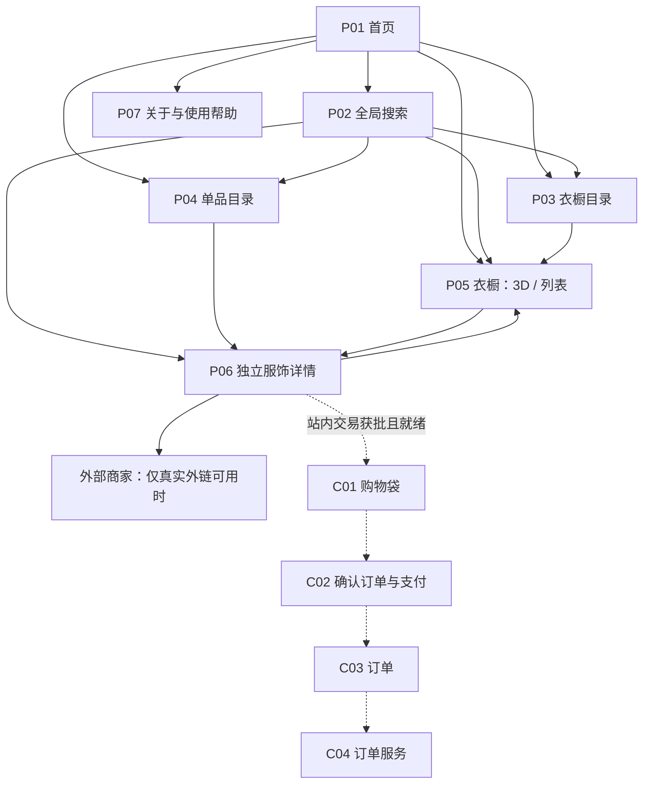

# 信息架构与搜索

整理批次：2026-10-15。阶段：产品文档与方案评审，尚未开始应用开发。

> 本文汇总需求讨论并补全导航、搜索与浏览路径。页面 ID、路由、筛选细节及候选业务模块均为建议，不代表已实现或已批准开发。
> 已确认体验依据为 2026-10-14—15 的需求对话；未明确选择的产品细节保持“建议／待决”。

相关文档：[需求说明](需求说明.md)、[功能清单](功能清单.md)、[技术决策](技术决策.md)。

## 1. 需求依据与决策边界

用户已明确的体验方向：

- 首页采用浅弧形立体衣橱轮播，包含衣橱预览、头像、姓名、风格文案和进入按钮。
- 手机触控横滑切换与点击操作已确认；切换按钮、序号和具体布局仍为建议。
- 使用暗色玻璃视觉语言，进入 3D 前提供横屏提示。
- 核心服饰本身必须是完整立体模型，选中后可以旋转观察。
- 选中服饰后通过射灯强调对象，并显示玻璃质感详情；桌面采用右侧详情方向。
- 参考网站用于讨论质感，不能将未实测的效果描述为本项目已达到的效果。

明星、风格、标签、品牌、品类五维搜索为本轮明确规划；匹配规则、建议列表、筛选布局及实施阶段仍为方案建议。

本次明确的 3D 要求替代旧文档中“至少一件真实模型、其余用图片”的核心候选方案。
首批数量仍未确认；图片、图片组及加载失败回退界面不计作核心真实 3D 达标。

仍待确认：

- 首批人物、衣橱与服饰数量，素材来源、合作和授权。
- 搜索资料覆盖率、商品身份、商家关系及价格库存来源。
- 外部商家导流、平台内交易或分阶段组合采用哪种商业模式。
- 额外仅图文目录、账号及首版功能范围。
- 技术栈、目标设备、性能阈值、内容维护方式。

## 2. 产品目标与体验原则

建议目标：让用户从人物、风格或商品需求出发找到衣橱和服饰，自由切换沉浸浏览与高效查找。

- 首页负责精选推荐，不是所有用户必须重复经过的入口。
- 搜索、筛选和阅读详情支持手机竖屏，不以旋转设备或加载 3D 为前提。
- 搜索、列表和 3D 使用一致的服饰身份、来源说明与商业状态。
- 旋转平面图片不能伪装完整服饰模型；背面缺失不能用推测冒充真实资料。
- 已发布、仅展示、可售、外链、站内交易和有库存分别表达。
- 无结果、内容暂缺与网络失败分别处理，不用推荐内容掩盖失败。
- 查询条件可见、可撤销、可分享，系统不得静默更改。
- 首版建议匿名即可完成发现、搜索、3D 浏览和详情阅读。

## 3. 核心实体与关系

| 实体 | 用途 | 关键边界 |
|---|---|---|
| 人物 | 统一姓名、别名、头像与相关衣橱 | 收录资料不等于本人合作或本人真实衣橱 |
| 衣橱 | 聚合空间、人物、风格及服饰展示关系 | 只向用户呈现实际可用且已发布内容 |
| 服饰条目 | 描述具体展示服饰、模型、细节和来源 | 核心可选择服饰均须完整立体模型 |
| 衣橱展示关系 | 记录服饰所在空间及展示语境 | 同品牌同款不自动成为同一件明星实物 |
| 品牌 | 规范名称、别名和关联服饰 | 不因出现商品而显示品牌合作标记 |
| 分类与标签 | 支持品类、颜色、风格与专题 | 受控属性与编辑专题分开维护 |
| 商业商品 | 记录商家、规格、渠道及可售能力 | 与展示服饰分开，不凭图片创造可售 SKU |

同一条目可有多个真实展示位置；人物归属、版本、穿着来源和对应商家商品分别校验。
价格、规格、成色和库存只在有可靠来源时提供。草稿不进入搜索、计数或公开直达链接。
发布状态、3D 就绪状态、商品身份、展示／销售用途和交易渠道应是独立信息。

### 产品模块对照

沿用 [PRD](PRD.md) 的 F01～F09；具体子项见[功能清单](功能清单.md)，不代表对应页面已经实现。

| 模块 | 对应页面／职责 | 边界 |
|---|---|---|
| F01 首页 | P01 | 浅弧、信息、进入和触控操作；具体控件布局建议 |
| F02 导航 | P01～P07 入口，P03／P04 目录 | 结构、标签入口与返回规则建议 |
| F03 搜索 | P02，连接 P03～P06 | 五维搜索纳入规划；算法、分组与筛选规则建议 |
| F04 衣橱／舞台 | P05 | 真实完整模型、聚光与选中路径 |
| F05 详情 | P06 及 P05 详情区域 | 服饰、模型、身份与商业信息一致 |
| F06 购买／交易 | 真实外链或候选 C01／C02 | 站内交易与供给本轮评估，实际模式未选 |
| F07 订单／服务 | 候选 C03／C04 | 仅交易能力确认后开放 |
| F08 内容／资产运营 | 内部受控维护和发布流程 | 候选 O01～O06，不预设新增公开路由或完整后台 |
| F09 质量／恢复 | 跨页分享、返回、设备与异常路径 | 信息回退不能计为核心 3D 达标 |

## 4. 页面地图

以下为建议结构。实线表示核心浏览关系；虚线为站内交易获批并真实可用后才出现的候选路径。

人物、品牌、风格与品类首版建议进入带条件的结果，不强制创建内容不足的独立专区。
购物袋、支付、订单及订单服务不是已上线模块，也不是当前浏览的默认前置需求。

## 5. 页面 ID、路由语义与入口出口

以下仅说明信息语义，不指定框架，也不表示仓库中已有相应路由。

| ID | 页面与路由建议 | 主要实体 | 主要入口 | 主要出口 |
|---|---|---|---|---|
| P01 | 首页 `/` | 精选衣橱、人物 | 品牌标志、直接访问 | 搜索、衣橱、全部目录 |
| P02 | 搜索 `/search?q=关键词` | 多实体匹配与条件 | 首屏、全局搜索、标签 | 衣橱、服饰、细化结果 |
| P03 | 衣橱目录 `/closets` | 衣橱、人物、风格 | 主导航、搜索分组 | 衣橱、搜索 |
| P04 | 单品目录 `/items` | 服饰与可用筛选 | 主导航、品牌／品类标签 | 详情、相关衣橱 |
| P05 | 衣橱 `/closets/:id?view=3d` 或 `view=list` | 空间与服饰 | 首页、目录、搜索、分享 | 详情、列表、原入口 |
| P06 | 服饰详情 `/items/:id` | 服饰、模型、来源、商业信息 | 搜索、列表、3D、分享 | 衣橱、真实可用交易出口 |
| P07 | 关于与帮助 `/about`、`/help` | 平台说明、操作帮助 | 菜单、异常提示 | 返回浏览、相关帮助 |
| C01 | 购物袋 `/bag`，候选 | 可站内购买的规格 | 合法可用的加入操作 | 结算、继续浏览 |
| C02 | 结算 `/checkout`，候选 | 商品、配送、支付信息 | 购物袋 | 支付结果、订单 |
| C03 | 订单 `/orders`，候选 | 当前身份有权访问的订单 | 成交结果、交易导航 | 详情、订单服务 |
| C04 | 服务 `/orders/:id/service`，候选 | 对应订单的服务请求 | 订单详情 | 订单、服务进度 |

服饰分享链接可带所属衣橱与选中条目上下文，不只将接收者送回首页。
搜索条件建议进入 URL；临时相机角度和面板开合不要求全部写入 URL。

## 6. 桌面与手机导航

桌面普通页面建议：

- 品牌标志返回首页；主导航为“发现衣橱”“浏览单品”。
- 全局搜索持续可达，提示“搜索明星、品牌、风格或单品”。
- 搜索、目录和详情提供当前位置及清楚返回路径。
- 人物、品牌和标签可点击进入相应条件结果。
- 仅站内交易获批且可用后显示购物袋与订单入口。

手机普通页面建议：

- 横滑与点击是已确认操作方向；以下导航位置、面板和状态恢复细节为建议。
- 顶部保留品牌标志及搜索按钮；底部建议“首页／衣橱／单品”带文字入口。
- 搜索建议、筛选抽屉、结果与详情完整支持竖屏。
- 搜索有明确关闭／返回，返回恢复原页面；键盘弹出不遮住提交操作。
- 不用悬停作为唯一操作方式，触控目标及文字可读性待目标设备验收。

3D 专用导航建议：

- 保留“返回”“当前衣橱”“搜索”“查看单品”，减少对场景的遮挡。
- 返回优先回到来路；直接访问时提供衣橱目录作为确定出口。
- 横屏提示建议提供“继续进入”和“浏览单品”，说明横屏更适合观察。
- 不强制旋转；竖屏与设备限制不阻断图文详情。
- 关闭详情保留选中对象，可明确取消选择；详情不完全遮住服饰。
- 手机横屏可收起侧栏，竖屏建议可收起底部面板；具体手势仍为提案。

## 7. 首页首屏快捷搜索

- 首屏建议可直接输入；手机至少提供明确“搜索衣橱与单品”入口。
- 搜索不埋在菜单中，不要求先选明星或操作轮播。
- 可提供少量实际有内容的风格／品类快捷标签，点击后条件可删除。
- 空搜索页展示精选衣橱与编辑策展；没有统计时不写“热门搜索”。
- 无内容标签不占首屏，不用不存在的人物或品牌引流。
- 不默认建设跨设备历史；若增加本地历史，需可清除。
- 搜索后返回首页保留轮播选中位置；不自动轮播打断阅读与点击。

## 8. 搜索意图与匹配

五维搜索的覆盖目标已明确；下表的识别方式、结果顺序及额外衣橱名搜索为建议，不把算法或首版分期写成已定。

| 输入意图 | 建议识别方式 | 结果重点 |
|---|---|---|
| 明星姓名／别名 | 维护过的规范名及中英文别名 | 相关衣橱与服饰 |
| 衣橱名称 | 标题精确或词项匹配 | 对应空间 |
| 风格／标签 | 受控词表，显示条件 | 相应衣橱与服饰 |
| 品牌 | 规范名及别名 | 品牌服饰与所在衣橱 |
| 服装品类 | 分类及常见同义词 | 对应服饰 |
| 多条件描述 | 仅解析有可靠依据的片段 | 可撤销条件及原查询 |
| 直接链接 | 恢复内容身份 | 指定衣橱或服饰 |

- 优先姓名／别名精确匹配，再明确实体、标题、标签及描述。
- 规范大小写和合理空格，不改变原始意图。
- 同名人物以头像、公开说明及衣橱区分，不自动合并。
- 已识别品牌、风格、品类显示为带维度的标签，避免混为同一类。
- 无可靠解析时保留关键词查询，不承诺理解所有自然语言组合。
- 纠错只提供建议，由用户选择；不静默改成另一位明星或品牌。

## 9. 建议与结果分组

输入建议分为“人物／衣橱”“品牌”“风格与品类”“单品”，清楚显示实体类型。
建议只来自可访问内容；品牌与标签进入对应条件结果，而不是未经建设的专区。
建议结果页提供“全部”“衣橱”“单品”三个主视图。

- “全部”按类型展示有限数量及“查看全部”。
- 人物精确命中先显示人物摘要与衣橱，再展示相关服饰。
- 品牌或品类查询优先展示匹配服饰，附相关条件入口。
- 无人物主页时，点击人物进入该人物条件结果。
- 不重复包装同一衣橱来夸大数量；计数仅含匹配的已发布内容。
- 衣橱卡展示人物、预览、风格及进入操作。
- 单品卡展示名称、衣橱归属、品牌、原件／同款／相似身份与真实商业状态。
- 3D 能力标记仅用于真实完整模型；额外图文内容不得使用同一标记。
- 加载中、无匹配与请求失败必须不同。

## 10. 分类与标签

| 维度 | 建议规则 |
|---|---|
| 人物 | 稳定身份；别名归并；不猜测关联 |
| 品牌 | 规范名、显示名、别名分离；不伪造合作 |
| 品类 | 清楚的一级／二级分类，避免无限细分 |
| 风格 | 维护有限词表，例如极简、街头、复古；示例不表示已收录 |
| 颜色 | 统一基础色，特殊色补充描述 |
| 场合 | 资料足够时再增加，例如日常、演出 |
| 编辑专题 | 明确主题，区别于服饰固有属性 |
| 商品身份 | 原件、同款、相似、待核实；区别于品牌与风格 |
| 商业状态 | 独立字段，不是任意填写的营销标签 |

衣橱风格概括空间或策展；单品风格描述服饰，两者不强制相同。
不确定的品牌、年份或人物归属不作为已确认筛选字段。
维护词表的流程待定，不因本文自动批准完整后台建设。

## 11. 筛选、排序与恢复

衣橱建议筛选人物、风格、专题；单品建议筛选人物／衣橱、品牌、品类、颜色、风格与真实商业能力。

- 同维度多选采用 OR，例如黑色或白色；跨维度采用 AND，例如黑色且为外套。
- 当前条件均可移除，提供清空；不静默放宽以填充结果。
- 手机抽屉展示已选条件和“查看 N 个结果”，不只使用图标。
- 无效选项展示数量或不可选状态；保留明确可解释的筛选逻辑。
- 有关键词默认相关度；无关键词建议精选或最近收录。
- 最近收录不能写成最新上架，两者业务含义不同。
- 无可靠价格及统一币种或透明换算规则时，不提供跨币种价格排序。
- 外链存在不等于可售或有库存；购买筛选只用真实状态。
- 核心可选服饰必须完整模型，不能用筛选隐藏未达标核心资产。
- 额外图文目录如获批，须明确能力边界，不稀释核心 3D 验收。
- URL 保存查询、条件、排序与类型；返回恢复条件及滚动位置。
- 新查询不被旧请求返回覆盖；相机和面板状态可在当前会话保留。

## 12. 原件、同款、相似与模型身份

以下为建议的资料分类，不表示已有可核实明星资产。

- 原件：有依据表明为人物实际持有／穿着的具体物件，记录证据与适用范围。
- 同款：品牌、型号及关键版本可核实一致，不宣称是人物本人持有的那一件。
- 相似：仅风格、廓形等近似，明确“相似推荐”，不标明星同款。
- 待核实：证据不足时不升级身份，可暂不纳入相应筛选。
- 展示模型对应哪件服饰、来源如何、与商家商品是否一致，分别说明。
- 原件身份不等于获准出售；同款外链不等于购买原件。
- 版本、颜色或材质存在差异时明确差异，不用近似模型冒充实物精确复刻。
- 可点击身份说明查看依据摘要；不得公开不必要的私人资料。

## 13. 展示、可售与交易出口

发布、模型就绪、商品身份、是否仅展示、交易渠道及库存可用性分别表达。
| 真实能力 | 建议界面与操作 | 不允许的推导 |
|---|---|---|
| 仅展示 | 保留模型、资料与来源，标“仅展示” | 不出现购买按钮或虚构价格 |
| 有真实外链 | “前往商家”，说明离开本站 | 不承诺本站付款或履约 |
| 外链库存未知 | 说明以商家为准，展示已知信息 | 不宣称有货或限量 |
| 站内交易获批且可用 | 按真实规格、库存提供购买／购物袋 | 不仅因界面存在就声称交易上线 |
| 已知售罄／不可购买 | 保留展示，说明实际状态 | 不提供无效结算 |
| 内容已下线 | 说明无法访问，提供继续浏览 | 不暴露草稿信息 |

站内交易为候选阶段，支付、配送、税费、退款、售后及订单权限需另行完整确定。
多渠道同时有效时分别说明来源，不默认将外部导流转换为站内购买。
价格必须注明币种；无可靠数据可以省略，不填占位价。

## 14. 3D、列表、详情与降级

- 核心选中服饰的旋转必须显示实际模型背面、侧面和关键结构。
- 搜索／列表可以进入对应衣橱并定位同一服饰；3D 与列表切换保留选择。
- 独立详情“在衣橱中查看”仅在场景可用时显示；分享恢复条目与上下文。
- 资料可先显示、模型按需加载；未加载模型不能假称成功。
- 失败提供重试与“浏览单品”；无 WebGL 或低端设备仍可阅读相同已发布资料与可用商业出口。
- 等价路径指信息与任务可完成，不表示回退图片达到 3D 标准。
- 横滑和点击已确认；手势边界、键盘、返回、取消选择及减少动态效果的具体行为仍需验证。

## 15. 匿名、登录与异常

- 建议匿名浏览、搜索、筛选、查看模型／详情及打开真实外链。
- 收藏、社区及用户上传不自动进入首版，不放置未建设的空入口。
- 交易获批后再评估访客结算与登录时机；登录需解释用途并恢复原操作上下文。
- 不承诺跨设备同步未建设的收藏、搜索历史或相机状态。
- 关键词无匹配保留原词；筛选无匹配显示全部条件，支持逐项删除。
- 尚未收录明确覆盖范围；推荐另标，不伪装为搜索命中。
- 请求失败提供重试，不显示“0 个结果”；模型失败与内容不存在分开。
- 已下线提供原结果／目录出口；外链失效保留站内资料，不伪造替代商家。

## 16. 核心旅程

| 入口 | 主要路径 | 成功结果 |
|---|---|---|
| 首页 | 预览 → 身份与风格 → 衣橱 → 选中并旋转 | 理解空间并观察真实立体服饰 |
| 明星名 | 正式名／别名 → 准确人物 → 衣橱或单品 | 找到实际收录内容 |
| 风格／标签 | 条件入口 → 衣橱／单品 → 筛选 | 找到符合审美的内容 |
| 品牌／品类 | 搜索 → 筛选 → 详情 → 可用出口 | 理解身份及购买路径 |
| 分享 | 指定详情 → 模型／资料 → 对应衣橱 | 不从首页重新寻找 |
| 低端手机 | 竖屏搜索 → 列表 → 详情 → 可用出口 | 无 3D 也能完成信息任务 |
| 候选交易 | 合法规格 → 购物袋／购买 → 结算 → 订单服务 | 仅整链获批且就绪后开放 |

## 17. 建议验收标准

1. 正式名与维护过的别名找到同一人物；无内容时不生成伪造衣橱。
2. 首屏能直接搜索，结果与建议可辨认实体类型和实际数量。
3. OR／AND、条件删除、清空、分享恢复和返回滚动位置符合约定。
4. 无结果不自动改词或放宽；失败、下线及模型失败分别显示。
5. 竖屏可搜索、筛选、看详情；3D 与直接访问都有明确出口。
6. 核心可选服饰均为完整可旋转模型；图片旋转或回退不算通过。
7. 列表、3D、详情与分享对应同一条目；选中对象不被面板完全遮挡。
8. 低端／无 WebGL 可完成信息任务，但不将其记录为 3D 品质达标。
9. 原件、同款、相似与待核实可区分；销售能力不由身份自动推出。
10. 仅展示、外链、可售和站内交易操作符合真实能力，不出现虚假库存、价格或订单承诺。
11. 匿名浏览不被无必要登录阻断；未发布资料不出现在搜索、计数及直达链接。
12. 键盘可操作建议、筛选和详情；关闭后焦点返回合理位置。

## 18. 后续验证与范围控制

建议观察搜索后点击、无结果、筛选后无结果、进入衣橱后选中服饰及真实商业出口点击。
这是待评估分析需求，不代表已安装统计或已取得数据。
自然语言复杂理解、个性化推荐、收藏、社区、品牌专区及完整交易链需单独评估。
本文件只定义产品方案，不授权应用编码、部署、购买服务或商业承诺。
