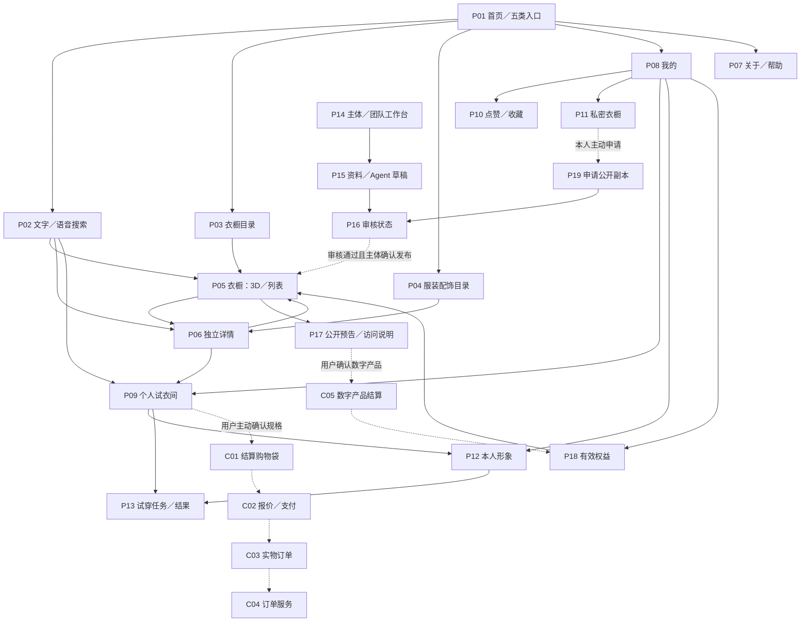

# 信息架构与搜索 · v0.3

更新日期：2026-10-15（新加坡时间）。状态：产品定位更新与需求方案，应用尚未实现。
依据：本轮用户新增定位；确认方向不等于开发授权、已选 MVP 或能力已验证。
相关文档：[PRD](PRD.md)、[功能清单](功能清单.md)、[需求说明](需求说明.md)、[实现架构与功能映射](实现架构与功能映射.md)。

## 1. v0.3 已明确方向与未决边界

- 平台从明星衣橱扩展至五类公共发现入口：明星、网红／穿搭博主、品牌主题／秀场、风格主题、审核通过的个人。
- 五类不是互斥账户类型；个人／组织主体、团队角色、衣橱主题及风格标签独立，允许交叉联名。
- 明星／团队和创作者提交照片、视频及语音，Agent 辅助形成建橱草稿，再经审核发布。
- 大众可文字／语音找服装配饰，AI 按诉求选择组合并加入个人试衣间；可撤销，不自动购买。
- 本人形象建档后可发起试穿；浏览公共内容不要求上传人体资料。
- 点赞与收藏进入产品范围；持久个人私密衣橱超过待定数量阈值后付费，内容仅自己可见。
- 明星受限内容可通过小额付费数字门票解锁；价格、期限及订阅形式待定。
- 入驻付费或免入驻费后交易分成作为商业选项，平台与创作者均有份额；比例及适用范围未定。
- 保留浅弧主卡、暗色玻璃、手机横滑／点击、横屏提示、聚光舞台和右侧玻璃详情。
- 所有核心可选中旋转服饰须有完整真实三维模型；GLB/glTF 仅为候选格式，图片回退和生成的试穿图不计作核心 3D 达标。

尚未选择首版范围、模型覆盖数量、技术栈、精度／实时性指标、费用阈值、分账比例或真实交易接入。
照片、视频或语音输入不能被描述为自动、即时生成精确完整模型；缺失资料必须补采、制作并核验。
旧版“收藏／上传／试穿不进入当前产品范围”由本定位替代；上线阶段仍需单独评审。

## 2. 公共发现入口与核心实体

| 发现／准入入口 | 内容重点 | 交叉关系 |
|---|---|---|
| 明星 | 本人／团队授权的审美、服饰与受限内容 | 可同时属于品牌联名或风格专题 |
| 网红／穿搭博主 | 创作者搭配与主题空间 | 不因公开身份即拥有品牌销售权 |
| 品牌主题／秀场 | 品牌、系列、秀场与联名策展 | 主体可为组织，团队角色另管 |
| 风格主题 | 极简、运动等审美或编辑策展 | 主题不是新的账户或实物归属 |
| 审核通过的个人 | 主动申请公开的个人空间 | 私密资料不因收藏或付费自动公开 |

所有公共入口都需真实性、资料与内容审核；同一衣橱可命中多个入口，按稳定 ID 去重。
“公共可发现”与“内容免费”不同：公开主页可含获准预告和受门票保护的内容层。

| 实体 | 用途与边界 |
|---|---|
| Owner／TeamMembership | 个人／组织主体及成员权限；人物资料 Person 不等于所有衣橱的所有者 |
| PublicWardrobe | 审核通过的公开发布版本，关联主体、主题、标签和可见范围 |
| 服饰／配饰条目与商业商品 | 展示身份、模型及来源与可售 SKU／Offer 分开 |
| Like／Favorite | 轻反馈与引用收藏，不代表拥有实物、已购买或永久获得门票 |
| FittingRoom／Line | 待考虑、待搭配的商品组合，是购物车延伸，但尚未成为订单 |
| PrivateWardrobe／Asset | 用户持续整理的私密资产／引用，仅本人可见，区别于临时待买清单 |
| Cart／Quote／Order | 明确选择规格并进入结算的商品、报价与订单，区别于试衣间 |
| AvatarVersion | 本人形象及授权、版本、表示范围；不默认等同精确人体测量 |
| TryOnJob／Result | 特定化身与服饰版本的试穿任务和结果，不能保证合身或实时性 |
| MediaAsset／Consent／AIJob | 原始资料、使用授权、语音转写和 Agent 任务，均有主体与权限范围 |
| DraftVersion／ReviewDecision | 建橱草稿及审核结论；草稿不进入公共搜索 |
| DigitalProduct／Entitlement | 门票／容量等数字产品与实际有效权益，不能仅凭付款回跳解锁 |
| AttributionSnapshot／SettlementLedger | 来源归因、平台与创作者份额和调整记录；不和前台排名混用 |

收藏引用、试衣间候选、私密持久资产、结算购物袋、化身和数字权益必须分别保存与展示。
将条目放进私密衣橱不扩大其原有内容许可；受限原图、语音和 GLB 仍须检查有效权益。

## 3. 产品模块与页面职责

沿用 F01～F09，新增 F10～F15；子项和阶段建议见[功能清单](功能清单.md)，不重排旧编号。

| 模块 | 页面／职责 |
|---|---|
| F01 首页 | 五类入口与浅弧精选，卡片呈现主体头像／品牌标识、名称、风格和进入 |
| F02 导航 | 公共目录及“我的”私域导航，创作者／团队工作台分开 |
| F03 搜索 | 人物／创作者、风格、标签、品牌、服装配饰品类，文字与语音 |
| F04 衣橱／舞台 | 公共或获权内容的 3D、选择、聚光及列表 |
| F05 详情 | 实物／同款／相似、来源、模型、规格及真实商业状态 |
| F06 购买／交易 | 结算购物袋、报价、付款及真实供给 |
| F07 订单／服务 | 实物订单、物流、取消、退款与服务 |
| F08 内容／资产运营 | 资料、词表、模型、发布版本、索引与异常处理 |
| F09 质量／恢复 | 分享、权限、缓存、设备、降级与恢复 |
| F10 入驻 Agent | 主体／团队入驻、资料授权、建橱草稿、审阅及发布 |
| F11 个人试衣间 | 诉求、AI 组合、批量加入／撤销和手动转结算 |
| F12 化身／试穿 | 本人形象授权、版本、试穿任务及结果 |
| F13 点赞／收藏／私密衣橱 | 反馈、收藏引用、本人持久资产及容量付费 |
| F14 门票／订阅权益 | 小额受限内容与容量等权益；是否订阅、续费方式待决 |
| F15 归因／分账 | 入驻费用选项、创作者与平台份额、退款调整及对账 |

## 4. 页面地图

以下是建议页面关系，不代表已实现；交易、付费与试穿入口按真实能力开放。

图中访问说明页不授予权限；搜索、分享、缓存、AI 检索及 3D 资产都必须独立校验。

## 5. 页面 ID、建议路由与出入口

路由只表示语义，不指定技术；P01～P07、C01～C04 保留，新增编号不覆盖旧页。

| ID | 页面／路由建议 | 主要入口与出口 |
|---|---|---|
| P01 | 首页 / | 五类可叠加入口 → 搜索／公共衣橱 |
| P02 | 搜索 /search | 文本、语音、标签 → 衣橱／服饰／AI 组合 |
| P03 | 衣橱目录 /closets | 按主体、入口、主题发现 → P05 |
| P04 | 单品目录 /items | 服装／配饰筛选 → P06 |
| P05 | 衣橱 /closets/:id?view=3d或list | 场景、详情、受限访问说明 → 原入口 |
| P06 | 详情 /items/:id | 来源衣橱、收藏、试衣间、真实可用购买出口 |
| P07 | 关于／帮助 /about、/help | 使用说明与异常出口 |
| P08 | 我的 /me | 点赞收藏、私密衣橱、试衣间、形象、权益、订单 |
| P09 | 试衣间 /me/fitting-room | AI／手动加入 → 组合编辑、试穿、主动转结算 |
| P10 | 点赞／收藏 /me/favorites | 公开可访问内容引用；失权内容不展示受保护资料 |
| P11 | 私密衣橱 /me/wardrobe | 本人持久资产、容量 → 主动申请公开 |
| P12 | 本人形象 /me/avatar | 明示授权上传／修改 → 选择版本试穿 |
| P13 | 试穿 /me/try-ons/:id | 本人任务进度、结果、重试或删除 |
| P14 | 工作台 /studio/:tenantId | 入驻方案、团队、草稿、内容及收益入口 |
| P15 | 建橱 /studio/:tenantId/build | 照片／视频／语音 → 可修订草稿 |
| P16 | 审核 /studio/:tenantId/reviews/:id | 补资料、审核结论、批准发布或撤回 |
| P17 | 访问说明 /closets/:id/access | 仅获准预告 → 明确数字产品及费用 |
| P18 | 权益 /me/access | 门票、数字订单与容量权益，区分有效／失效 |
| P19 | 公开申请 /me/wardrobe/publish-request | 本人选择资料与公共副本 → 审核 |
| C01 | 结算购物袋 /bag | 用户选规格 → 最终报价，区别于试衣间 |
| C02 | 实物结算 /checkout | 确认费用／付款 → C03 |
| C03 | 实物订单 /orders | 合法订单与履约，区别于数字订单及访问权益 |
| C04 | 订单服务 /orders/:id/service | 取消、退换及退款，不因访问链接跳过订单身份 |
| C05 | 数字结算 /access/checkout | 门票／容量产品 → 可核验数字订单及权益 |

后台审核、账务与团队管理仅授权角色可访问，不作为公共发现入口。
私密分享 URL 不构成授权；无权访问时不泄漏名称、缩略图、人体资料或资产地址。

## 6. 主体、团队与入驻建橱

主体为个人或组织，明星、博主、品牌、风格与个人入口不强制创建不同账户。
建议角色分为主理人、编辑／建橱成员、团队审批、财务；平台审核／运营权限单独管理。
- 所有读写按所属主体和具体职责核验；加入一个品牌团队不授予其他团队资料或私人化身访问。
- 团队内确认不替代平台公共准入审核；代理提交需核实本人／组织授权。
- 入驻付费与免入驻费后分成作为方案选项，先说明费用、适用交易和平台／创作者份额。
- 选择商业方案不自动发布、获得品牌销售授权或生成支付／供货资格。

建议状态机：
1. 主体申请草稿 → 身份／代理授权待核实 → 待补充／不通过／主体有效。
2. 资料接收 → 授权及质量检查 → 转写待确认 → Agent 处理中／失败可重试。
3. 草稿待补资料 → 创建者审阅／修订 → 明确提交平台审核。
4. 审核中 → 退回修改／不通过／通过待发布 → 主体确认发布。
5. 已发布 → 内容修订新版本／撤回／授权失效暂停；新版本未获批不得替换公开内容。

照片、视频和语音均记录来源、使用范围与撤回状态；录音转写不等于许可克隆本人声音。
Agent 输出空间、单品与素材需求草稿，不自动确认品牌、原件身份、实物尺寸或缺失背面。
资料不足时生成待补项，完整 GLB 仍需制作、核验与审批；失败保留已确认资料，不重复收费或重复发布。

## 7. 桌面、手机与私域导航

- 桌面建议：发现衣橱、服装配饰、统一文字／语音搜索；右侧独立试衣间与“我的”。
- 公共发现支持五入口交叉筛选；发布主体和风格主题独立展示。
- 手机建议“发现／搜索／试衣间／我的”，公共目录在发现与搜索内可达；布局仍需评审。
- “我的”区分点赞收藏、私密衣橱、试衣间、本人形象、数字权益及实物订单。
- 创作者／品牌工作台切换必须显示当前主体，不把组织内容和用户私密资产混在一起。
- 未登录可完整浏览获准公共信息；点赞收藏持久化、个人试衣间等需要保存时解释登录用途。
- 未登录的暂存组合是否支持为建议；登录后应预览合并，不丢旧组合或重复添加。
- 浏览和普通搜索不要求上传本人照片、视频、身体尺寸或声音样本。
- 语音是可选入口，拒绝麦克风权限后可继续文字输入。
- 3D 简化导航保留返回、当前衣橱、搜索及列表；触控横滑和点击为已确认操作。
- 横屏提示与暗色玻璃保留；竖屏列表替代、按钮序号及面板布局为建议。
- 分享或后退恢复原条件；进入受限内容前先验证权益，不靠按钮隐藏保护内容。

## 8. 文字／语音搜索与结果组织

公开发现支持主体／人物、风格、标签、品牌、服装与配饰品类；同名和别名规则为实现建议。
“公共发现”和“我的内容”明确分区；个人内容只在本人范围查询，不进入公共或跨用户 AI 索引。
输入建议按主体／衣橱、品牌、风格／标签、品类与单品分组，标签含维度，不混为同类。
结果建议保留“全部／衣橱／单品”；确切人物／主体命中优先，单品可进一步生成组合。
同一衣橱在多个公共入口只计一次；无权结果不泄漏受限标题、数量、语音文本或隐藏缩略图。

语音建议流程：
1. 用户主动开启录音并授权 → 明确录音状态和停止／取消。
2. 转写后显示可编辑文本；低置信、同名品牌、预算币种等关键歧义请用户纠正。
3. 用户确认可按原文本搜索；复杂意图抽取仅解析有依据的片段。
4. 网络失败、转写失败、权限拒绝或取消都回到可编辑文字，不自动提交另一种意图。
5. 原音保存目的、期限与删除方式需确定；不默认用录音训练或克隆声音。

匹配、纠错、实体分组和排序规则仍为建议；不得静默改词、删除预算或放宽不可替代条件。
空查询可给编辑精选；没有数据不写热门。无结果、资料未收录与请求失败分别显示。
公开可见的门票预告可被检索；受保护正文、语音、模型只能在有效权利范围召回。

## 9. 筛选、排序与 AI 约束

- 可筛公共入口、主体／人物、主题、风格、标签、品牌、服装／配饰品类及真实商业能力。
- 同维度 OR、跨维度 AND；多入口交叉结果按 ID 去重，条件可单独删除与清空。
- 手机抽屉显示已选与结果数；不因结果少而自动放宽。
- 查询、条件、排序及公开结果类型可进 URL；个人需求、人体数据和私密检索词不放公开分享链接。
- 默认相关度／精选／最近收录；收录时间不是上架时间，外链不是有货证明。
- 未知币种、价格、库存不伪造；无可靠换算口径不跨币种排序。
- AI 先呈现已识别诉求：场景、风格、品类、预算／币种、尺码偏好及不可接受项，用户可修改。
- 硬约束与可协商偏好分开；不得用相似款偷偷替换用户指定原件／同款。
- 使用本人资料或历史偏好需在获准范围；不因搜索自动建立人体档案。
- 候选受权限、真实可售状态和供应资料约束；仅展示内容若用于灵感须明确不可购买。
- 预算总额说明含哪些费用；费用未知不宣称符合全包预算，超预算需重新选择或明确同意。
- 缺货、无尺码或无解时给出可解释替代／拆组建议，不自行增加预算或换货。

## 10. AI 组合、试衣间与结算边界

用户已要求 AI 按诉求选择组合并加入试衣间；下列确认、回滚及冲突处理是建议实现细节。
- 在用户当前指令授权范围内组装；展示组合、来源、身份、价格状态与选择理由。
- 指令未明确授权加入时先展示提案；授权加入也只到个人试衣间，不代为购买、解锁或公开。
- 每次组合添加有可辨识批次，反馈成功／失败条目；重试不重复添加。
- 支持整组撤销和逐件移除；撤销恢复添加前状态，不误删用户原有条目。
- 已有相同条目、规格未选、部分缺货或价格变化须明确，不静默合并成错误数量。
- 并发编辑时保留较新用户修改；不能用 AI 迟到结果覆盖用户调整。
- 试衣间保存待考虑组合，可包含明确标记的搭配参考，不表示购买、拥有、锁库存或获得门票。
- 用户可继续搭配、选择本人形象试穿，或手动确认规格转入结算购物袋。
- 转结算重新核验商品、规格、库存、费用及权限；超预算／缺货须用户重新确认。
- 传统结算购物袋、报价、实物订单不与试衣间合并；AI 不自动支付或订阅。

## 11. 本人形象、试穿与私密持久资产

- 形象建档在本人主动试穿时引导，说明上传用途、可用资料及删除／撤回方式；不绑架浏览。
- AvatarVersion 关联本人授权及表示范围；使用指定版本发起任务，不跨用户借用人体资料。
- 试穿有待处理、处理中、需补资料、失败、完成等状态；结果显示对应化身及服饰版本。
- 生成结果、尺寸建议和真实 GLB 观察分别标注；不保证精准合身、实时渲染或实物颜色一致。
- 身体资料缺失时允许返回试衣间，不自动捏造尺寸或偷偷复用旧档案。
- 点赞是反馈，收藏是引用，私密衣橱是本人持续整理的资产；都不自动证明已买实物。
- 用户明确选择才把收藏／试衣间条目整理到私密衣橱；不自动复制付费保护素材。
- 私密衣橱默认且持续仅本人可见，不因付费、试穿、分享链接或到达阈值自动公开。
- 超过待定数量阈值后付费；计数对象、免费额度、容量产品、价格及到期处理需确认。
- 容量不足先说明与提供整理／升级选择，不暗删旧资产或擅自扣费；不默认自动续费。
- 主动申请公开时选择拟发布资料，建立隔离公共副本，经完整审核才发布；撤回不公开原始私密库。

## 12. 数字门票与访问权限

明星私密内容的付费访问不等于私密衣橱所有权，也不等于实物购买或永久素材下载权。
数字产品应说明覆盖内容、费用币种、可用期限、是否一次性／订阅、退费与失效条件；具体数值未定。
建议先核验数字订单与权益再开放内容；失败付款、重复回调或页面跳转不构成解锁。
- 搜索：公共索引只含获准公开预告；受限检索按有效权益过滤，私密库按本人过滤。
- 分享：链接不携带访问令牌、不扩大许可；接收者独立校验，无权仅见获准预告。
- 缓存：按主体、可见性、权益范围和版本隔离；撤权／下架后清理受影响缓存与索引。
- AI 检索：在召回与生成前过滤，不能通过摘要、转写、推荐理由泄漏门票或私密内容。
- 3D 资产：清单、贴图、语音、GLB 与下载／流式请求均校验；不能仅隐藏页面按钮。
- 私域：收藏、试衣间和私密衣橱保存引用不延长权限；到期／退款后停止提供受保护资产。
- 状态：门票有效、过期、退款／撤销、容量不足分别说明；重新购买不能自动发生。
会员、门票、容量、实物订单及创作者团队资格是不同权益，彼此不自动替代。

## 13. 商品、商业状态与归因

原件、同款、相似与待核实分开，模型精美不证明人物归属或精确扫描。
仅展示、有真实外链、站内可售、库存未知、售罄／失效分别展示，不生成虚构价格或库存。
品牌／创作者可选择获准入驻商业方案；免费入驻不等于没有交易分成，入驻费不等于无限销售授权。
平台与创作者份额作为方向保留；费率、计费事件、商家／供货方份额及支付费用由后续协议决定。
建议组合／商品保留来源衣橱、创作者及商业映射的归因快照；付费推广不得伪装 AI 的中性理由。
实物、数字门票和容量产品分别记录收入、退款与权益影响，不能按加入试衣间就记成交。
分账用实际有效订单及约定事件结算；退款、撤单、重复回调做可追溯调整，不重复计提。
工作台按主体展示应有收益和状态；无权团队成员不见其他主体账务或个人原始媒体。

## 14. 核心旅程与可验收标准

| 旅程 | 成功结果 |
|---|---|
| 五类发现 → 公共衣橱 → 服饰 | 入口可交叉，主体／主题不混淆，核心完整真实三维模型可旋转 |
| 创作者／团队 → 授权资料 → Agent 草稿 → 审核发布 | 不凭输入自动发表；补资料与退回可继续 |
| 文字／语音找服装配饰 → AI 组合 → 试衣间 | 诉求可纠正，预算与缺货明确，组合可撤销且不购买 |
| 试衣间 → 本人形象 → 试穿 | 用户主动建档，任务可恢复，不宣称精确实时 |
| 点赞／收藏 → 私密衣橱 → 容量选择 | 实体不同，阈值未知不伪造，持久资产仅本人 |
| 私密衣橱 → 主动公开申请 → 审核副本 | 不将原库、人体资料或付费素材自动公开 |
| 门票预告 → 明确付费 → 有效权益 → 内容 | 分享、缓存、AI 和 GLB 都不能绕过权限 |
| 用户主动转结算 → 订单 → 归因分账 | 库存费用重核；平台／创作者份额与退款可追溯 |

另须验证：拒绝麦克风仍能文字查找；匿名不上传人体可浏览；同名／别名可辨识；OR／AND 不静默放宽。
无结果、无权、下架、模型失败、AI 失败与试穿失败须不同且有出口；低端图文路径不冒充 3D 达标。
返回／刷新／方向变化恢复合法范围的状态，退出账号后不残留上一用户的试衣间、人体或门票资产。
所有验收待真实执行；本次只完成文档，不声称模型、AI、支付、试穿或权限系统已实现。

## 15. 待决定与阶段建议

需确认：首批入口／主体、资产和审核责任、模型数量与精度、语音资料保留、试穿方式、目标设备。
商业待决：容量阈值和计数、门票费用／期限、是否订阅、入驻商业方案、归因分账及退款规则。
建议分别验证公共发现与完整 GLB、授权建橱草稿、可撤销试衣间、形象试穿、数字权益及真实交易。
该顺序是建议，不代表用户已选 MVP；技术栈、预算、应用编码及真实交易接入仍须单独决定。
