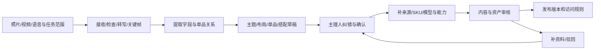

# 入驻与Agent建橱

版本v0.3 · 2026-10-15 · 产品方案，尚无可运行建橱Agent。对应F10，关联F08/F14/F15。

## 1. 服务目标

让主理人及团队用照片、视频与语音提供内容，由Agent整理成可纠正、可审核、可发布的策展衣橱。减少重复录入和空间编排，不承诺一段视频自动变成准确、可售、可试穿的完整3D资产。

公共发现覆盖明星、网红/穿搭博主、品牌主题、风格主题和审核通过个人。五类可交叠，owner为个人或组织，主题独立；例如品牌与博主联名可命中多个入口，但只有一个明确版本与责任归属。全部公共发布均经过适用审核，支付入驻费不购买免审资格。

## 2. 入驻与方案

| 环节 | 用户提供/决定 | 平台处理 | 输出 |
| --- | --- | --- | --- |
| 申请 | 主体、联系人、内容类型、拟提供资料 | 真实性、联系与角色关系核验 | 申请编号与待补项 |
| 成员 | 所有者、编辑、发布、财务等分工 | 邀请/接受、空间范围、撤销和审计 | 有效团队成员权限 |
| 方案 | 入驻服务包或免入驻成交分成等候选 | 展示服务对价、范围、费用及规则版本 | 可追溯方案选择，不自动成交 |
| 内容准备 | 本人/品牌关系、商品或主题来源 | 区分可展示、可销售、可建模与可试穿 | 内容与权利状态 |
| 持续运营 | 主题更新、补货、下架、售后联系人 | 内容质量、供给同步、异常和退出处理 | 可维护的发布版本 |

个人私密衣橱不是此入驻流程。消费者希望公开策展时需主动提出公共主理人申请，不能把原有私密照片、化身或试衣记录顺便转为公开。

## 3. 创作者工作台

建议包含申请与身份、衣橱列表、团队成员、资料箱、Agent任务、草稿、审核反馈、资产与商品映射、发布版本、内容权益、经营数据、结算和服务。

- 编辑只操作获准衣橱，不自动具有发布、退款或收款账户变更权。
- 品牌、合作关系与款式信息应有提供者和证据；工作台不能把勾选“明星”当身份认证。
- 收款主体、数字内容权利方、商品卖方可不同，必须分别记录，交由财务权限角色确认。
- 撤销团队成员后关闭新操作与长期凭据，不删除既有编辑与支付审计记录。

## 4. 多模态输入协议

| 输入 | Agent可提取 | 必须确认/补充 |
| --- | --- | --- |
| 服饰照片 | 可见轮廓、颜色候选、数量、细节区域 | 品牌、款式、材质、规格、关系证据，不可见背面 |
| 服饰/空间视频 | 连续视角、摆放分组、镜头建议与关键帧 | 是否完整覆盖、重复单品、真实位置和来源 |
| 语音说明 | 转写、主题、搭配意图、明确口述字段 | 转写纠错、指代对象、商品事实与发布意图 |
| 商品目录/链接 | 已获准接入的结构化资料与报价引用 | 外部内容不是供货合同，价格库存需时点与权限 |
| 既有3D资产 | 文件、材质、代表规格与结构检查 | 来源、完整度、单位、性能与实际商品对应 |

公开衣橱不需要真实住宅精确布局；上传者可使用选定模板或策展空间。资料可能包含无关人物/住址时，在公开前应清理或改用安全展示资料。格式、大小与时长限制要在上传前说明，实际数值待选择处理服务后确定。

## 5. 建橱任务链

1. 先确认任务是“整理草稿、建议布局或更新哪些内容”，不默认公开发布或购买外部素材。
2. 为上传、转写、提取、生成、审核分别提供状态，长任务可离开后继续查看；失败不返回伪成功。
3. 每个草稿字段保留来源、提取/推断类型、置信与人工确认状态。低置信或缺失的关键字段明确待补。
4. 合并重复单品前展示候选，保留全局商品与衣橱展示关系；同款不等于同一唯一实物件。
5. 模板与布局可自动建议；对外文案、商品事实、付费权益和发布版本需有合适角色确认。
6. 审核检查主体、来源关系、商品信息、内容、资产和能力标签；不由Agent自称“已认证”。
7. 发布时锁定版本与权限；修改后新版本再审，不能在已售内容中无记录替换交付对象。

## 6. 关键字段和证据

| 对象 | 最少字段 | 硬约束 |
| --- | --- | --- |
| 衣橱 | 标题、owner、主题、呈现性质、简介、预览、可见性 | 真实复刻/授权内容/编辑策展分别说明 |
| 单品展示 | 稳定商品ID、关系类型、名称、品类、媒体、来源 | 本人原物、推荐、同款、相似不混写 |
| 商品规格 | 颜色、尺码、材质资料、唯一件状态等 | 口述/推断不能替代核实的销售资料 |
| 资产 | 版本、来源、代表规格、完整度、支持能力 | 图片草稿不标真实旋转或3D试穿就绪 |
| 报价 | 卖方、供给、币种、库存时点、地区与费用 | 与展示和模型分别更新，不凭模型生成库存 |
| 付费内容 | 内容范围、预览、价格/期限、权利方、撤回退款政策 | 只卖有权提供的内容，明确访问边界 |
| 字段证据 | 输入片段、提供者、处理版本、人工确认 | 隐私原始资料不能随公共字段一起曝光 |

## 7. 独立状态，而非一枚“已完成”

| 状态轴 | 候选状态 | 防止的误读 |
| --- | --- | --- |
| 入驻申请 | 待资料/核验中/通过/拒绝/暂停 | 申请通过不等于商品审核通过 |
| AI任务 | 排队/处理中/待确认/成功/失败/取消/过期 | 草稿成功不等于模型准确 |
| 草稿/发布 | 草稿/待确认/待审核/已发布/撤回/归档 | 缴费不自动发布，私域不自动公开 |
| 单品能力 | 图文可读/真实旋转已验/试穿适配已验 | 衣橱漂亮不等于所有服装支持试穿 |
| 供给 | 待核/可展示/可售/缺货/停供 | 可观看不等于可买 |
| 数字权益 | 未售/有效/到期/退款撤权/内容停供 | 付款与内容实际交付分别追踪 |

建议模型生成作为异步任务，价格/用量先说明；任务重复提交有幂等键，重试关联原意图，不重复发权、发布或收费。若需额外付费建模/算力，明确确认后才执行。未经验证不能使用“实时精准生成已完成”的成功提示。

## 8. 审核、撤回与运营

- 内容审核与供应审核分工；禁止把可展示素材当可售授权。
- 主理人纠正错误后保留版本；被驳回应能看原因、修订和申诉。
- 衣橱撤回要同步新搜索、AI检索、公共预览、资产访问和新成交；历史订单与已售数字内容按规则处理。
- 支付独家内容若长期停供、无权提供或主理人退出，需服务、替代或退款路径，不能让已售入口永久空置。
- 质量指标包括草稿字段准确/缺失、人工修订时间、审核发布率、维护成本、真实可售率和后续净收益；不能把Agent生成数当运营成功。

## 9. 能力边界与交接

这条管线可以降低资料整理成本；精细服饰几何、可靠材质、合身适配与商品权利仍需专业资产与人工核验。任务编排负责过程，不制造模型或供给事实。

技术美术接收来源可用的模型任务与代表规格；Web3D接收已验证资产与能力标记；审核接收草稿证据；交易接收真实报价与销售责任；财务接收可追溯合同与分成规则；消费者只看到对应已就绪能力。

详细实现见[实现架构与功能映射](实现架构与功能映射.md)，个人形象与试穿另见[AI试穿与个人形象](AI试穿与个人形象.md)，收费方案见[商业模式与平台运营](商业模式与平台运营.md)。

## 10. 候选验收

1. 同一owner可有多主题，五入口交叠不重复主体或商品，团队范围可撤销。
2. 识别字段可回到具体输入，转写错误、重复单品、品牌不明和背面缺失均可纠正。
3. 上传或生成失败可恢复，重复任务不重复收费/发布，资料删除会阻止继续处理。
4. 只交照片的草稿不能显示“真实旋转/试穿可用”，额外建模费用在执行前明确确认。
5. 主理人付费不免审；编辑不能变更收款或查看消费者身体资料。
6. 付费内容资产、分享、搜索摘要及AI上下文按有效权益与内容版本过滤。
7. 改版、撤回和退场保留订单证据并处理售后，不能默默删除已售权益对应内容。
8. 消费者购买私密衣橱不会进入公开主理人目录，公开申请不自动发布原有私密资料。

这些是拟定要求，尚未运行Agent、接入供给或生成真实模型。
