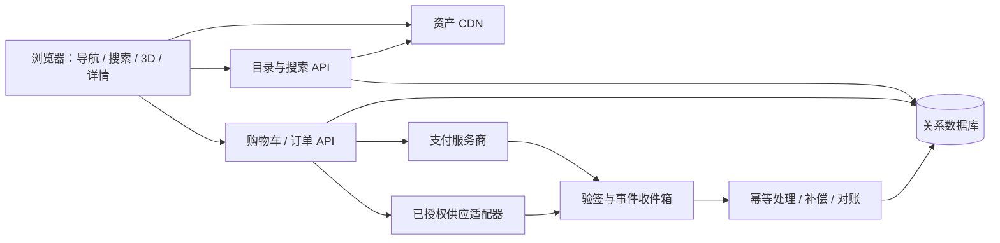

# 实现架构与功能映射

**静态发布补充（2026-10-15）**：用户已要求分别提供线上预览，因此本轮Slides与设计材料的静态发布已获授权；文中应用开发、真实交易与应用部署的限制继续适用。发布完成须以实际可访问的URL核验为准。

更新日期：2026-10-15。版本：v0.3。状态：产品需求到实现方式的技术草案，不是已实现功能清单。

本文件对齐产品模块 F01～F15；保留 ARC-F01～ARC-F22，新增 ARC-F23～ARC-F39，不重用旧编号。2026-10-16 为 F18 个人档案与 F12 多照片 3D 形象新增 ARC-F40～ARC-F43（D45～D47），这四项已获授权在 `app/` 比赛版实现，见 §14.1。
用户已要求完善产品、信息架构、实现方案、设计探索和静态 HTML Slides；这些授权本身没有解除网站应用编码限制。2026-10-16 现状：比赛版应用已按 D34、D44～D47 的授权在 `app/` 编码（分支 `feat/core-adapt-20261015`，未部署），已实现内容见 [app/README.md](../app/README.md) 与[交付记录](交付记录.md)；本文其余模块仍是技术草案。
当前没有已批准技术栈、已验证完整服饰 3D、AI 建橱/试穿、实际支付或供货接入；下列方案均须按相应阶段门验证。
用户确认的是完整、真实、可旋转的三维能力；GLB/glTF 是本方案优先候选交付格式，不是已批准的唯一格式。

## 一、体验要求与事实边界

- 首页采用浅弧形立体展示，中央衣橱最大且正对用户，两侧相邻衣橱部分露出。
- 左右切换改变中央对象；保留衣橱预览、明星头像、姓名、风格介绍与进入按钮。
- 视觉方向为暗色背景、玻璃卡片、投影、环境光和有层次的复杂光影。
- 手机支持手指切换和点击；进入衣橱前提醒横握，旋转后正确适配。
- 选中服饰后，以射灯和镜头聚焦中央舞台，右侧浮现半透明模糊玻璃信息卡。
- 服饰本身需要完整三维模型，可观察正面、侧面和背面；平面图片旋转不能算完成。
- 统一搜索、完整导航、详情维度、站内购买和后台供货整合属于本轮产品方案研究范围。
- 保留竖屏入口、首页先用渲染海报、具体技术栈和交易模式仍为建议，不是已确认实施决定。
- miniroom.5title.com 尚未完成实际体验，不依据未观察到的画面声称已达到或超过参考。
- 最新讨论扩大了产品研究范围，没有自动获得明星合作、素材权利或支付资格（比赛版应用编码另由 D34 授权）。
- v0.3 增加明星、网红、品牌主题、风格主题、审核个人五类公共衣橱入口；它们可重叠，不是互斥账户类型。
- owner 主体为个人或组织；团队成员角色、身份验证、衣橱主题、公开范围与审核态分别表达，支持品牌×风格×创作者联名。
- 各类公共衣橱都要审核；个人私密库只有主动申请后才生成待审公共副本，不能默认公开原始媒体。
- 入驻者可提交照片、视频、语音，由 Agent 生成待确认草稿；普通用户可语音挑服装/配饰加入试衣间。
- 用户上传本人照片/视频创建个人形象并一键试穿是新增目标；生成真实性、3D、合身与时延必须分别验证。
- 点赞、收藏、付费私密个人衣橱、小额门票、入驻费或免入驻交易分成属于产品方向，具体费用和合同尚未确定。
- 试衣间是待搭配组合，个人私密衣橱是持久资产，购物袋是待结算商品，不能共用一个列表假装三种能力。
- 个人照片默认不用于训练，可撤回并申请删除；第三方处理条款、派生删除和保留规则须在真实集成前核验。

## 二、总体建议与技术候选

一套目录同时驱动首页、搜索、普通列表、3D 场景和详情，避免各页面维护互相冲突的商品事实。
普通目录和文字详情承担检索、分享、可访问性与异常恢复；3D 承担空间体验和真实旋转观察。
同一鉴权规则覆盖普通搜索、AI 召回、详情、分享、3D 清单和资源下载；公共可发现不代表全部内容免费。
交易属于独立业务域，由服务端与已授权供货渠道交互，浏览器不直接调用供应或支付密钥接口。

| 决策 | 推荐方向 | 替代方案与选择条件 | 状态 |
|---|---|---|---|
| 前端 | React + TypeScript 作为候选，普通 UI 与 3D 分层 | 以团队技能和已批准路线为准，避免同时引入多个框架 | 待批准 |
| Web 渲染 | 目录与详情输出可索引 HTML，3D 按需载入 | Next.js 或站点加独立 API 均可；按 SEO、部署和团队能力选择 | 待选型 |
| 3D 引擎 | React Three Fiber / Three.js 优先比较复杂交互 | Spline 比较制作、导出、事件、触摸、性能、托管和费用约束 | 待同样板验证 |
| 业务 API | 模块化单体，目录与交易分域 | 小规模展示可先用版本化 JSON；真实交易必须服务端校验 | 推荐 |
| 数据 | 关系库管理内容关系、订单快照和资金账目 | PostgreSQL 为候选；不因概念阶段先拆微服务 | 待选型 |
| 搜索 | 受控词表、中文别名、筛选和可解释排序 | 达到实际规模或性能瓶颈再比较专用搜索服务 | 推荐 |
| 资产 | 对象存储、CDN、带版本的清单 | 小型概念图可入文档；原始工程和大模型单独管理 | 推荐 |
| 交易 | 单市场、单币种、单授权供应商先闭环 | 多商家拆单、跨境与多币种作为独立扩展 | 待业务确认 |
| AI 与媒体 | 上传/转码、ASR、结构化抽取、化身与试穿独立适配；任务异步 | 托管服务或自管推理分别核能力、合同、GPU 与延迟，不预选供应商 | 待验证 |
| 权限与权益 | 多租户 RBAC + 对象/权益校验，付费资源受控签名交付 | 不能只用前端遮罩或公开 CDN 隐藏链接 | 推荐 |
| 账本 | 实体商品、数字权益订单与账本分域，归因/分账保留版本 | 不用一个订单状态和可变百分比承担所有资金事实 | 推荐 |

AI 集中用于建橱、语音搭配、形象与试穿；普通名称搜索不必全部改成生成式回答，也不默认增加向量库或微服务。
用同一房间、同一真实服饰、同一设备比较技术，记录画质、触摸、加载和维护成本。
两天比赛样板可以先用静态目录与明确模拟交易；不能把它当作已完成正式平台架构。

## 三、功能—实现—验收—依赖矩阵

下表“验收”是后续验证方法，不代表已有测试或已通过结果。

| 子模块 | PRD | 用户价值 | 推荐实现与替代 | 验收重点 | 依赖 |
|---|---|---|---|---|---|
| ARC-F01 浅弧轮播 | F01 | 快速挑选衣橱 | 海报配透视变换；再比较实时 3D 卡片 | 中央最大、两侧可见，滑动与按钮结果一致 | 预览、交互原型 |
| ARC-F02 身份信息区 | F01 | 识别衣橱归属及风格 | 头像、姓名/名称、简介随对象同步，文字保持正面 | 图片与文案不串位，长名称不遮按钮 | 内容及头像来源 |
| ARC-F03 响应式/方向 | F01/F04/F09 | 手机自然进入空间 | 按可用尺寸布局，横屏提示后恢复选择 | 旋转不丢状态，宽屏不误提示 | 设备矩阵、方向决策 |
| ARC-F04 全局导航 | F02 | 知道位置并找到内容 | 语义导航、目录路由、明确返回 | 深链接可返回列表，键盘可达 | 信息架构 |
| ARC-F05 分类筛选 | F02/F03 | 按风格、品牌、类别缩小范围 | 受控分类和组合筛选 | 同组 OR、跨组 AND，数量与结果一致 | 标签体系 |
| ARC-F06 统一搜索 | F03 | 直接搜索人物和服饰 | 名称归一化、别名、关键词索引 | 标准名/别名命中，空结果可恢复 | 词表与检索集 |
| ARC-F07 搜索建议 | F03/F08 | 减少输入与歧义 | 按实体类型展示建议，人工维护别名 | 同名人物/品牌可区分，不编造匹配 | 内容运营 |
| ARC-F08 房间与镜头 | F04 | 从预览连续进入空间 | 清单、镜头预设、受控过渡 | 取消、返回、重复进入正常 | 房间资产与锚点 |
| ARC-F09 聚光舞台 | F04 | 聚焦服饰且保留空间关系 | 选择状态驱动灯光、镜头和面板 | 选择/取消/切换可恢复原位置 | 模型、灯光样板 |
| ARC-F10 真实 3D 观察 | F04/F05 | 看正、侧、背面与纹理 | 受控旋转、缩放和复位 | 无假背面、无明显穿模，操作可理解 | 完整模型及材质 |
| ARC-F11 详情 | F05 | 理解服饰、来源和购买条件 | 空间面板与独立页共用结构化内容 | 缺字段诚实展示，详情可分享 | 详情字段与证据 |
| ARC-F12 变体与报价 | F05/F06 | 选对颜色、尺码和购买对象 | Item、Variant、Offer 独立，模型明确映射 | 不静默换模型/商品，不把示意当实物 | SKU/资产映射 |
| ARC-F13 购物车与报价 | F06 | 知道实际总价和可售条件 | 服务端重算库存、税费、运费与时效 | 变化重新确认，失效商品可移除 | 市场及供应能力 |
| ARC-F14 结账支付 | F06 | 连续完成付款 | 安全支付组件或托管流程，订单可恢复 | 不重复扣款，认证返回可查证 | 主体与支付资格 |
| ARC-F15 供货编排 | F06/F07 | 付款后可真实履约 | 单供应适配器、查询、补偿、对账 | 超时/拒单/部分供货有明确结果 | 供货及售后协议 |
| ARC-F16 订单身份 | F07 | 找回订单和查进度 | 游客安全访问为候选，账号按需扩展 | 无法访问他人订单，支付回跳可恢复 | 身份及通知策略 |
| ARC-F17 退款支持 | F07 | 异常有处理路径 | 退款独立记录、余额校验、人工入口 | 部分退款及重复回调正确 | 规则及运营责任 |
| ARC-F18 内容运营 | F08 | 持续得到准确信息 | 草稿、预览、发布、下架及版本 | 草稿不公开，下架同步检索 | 编辑与发布权限 |
| ARC-F19 资产运营 | F08 | 获得一致视觉质量 | 资产检查、质量档、清单和回滚 | 错误资产可定位和撤回 | 制作与来源记录 |
| ARC-F20 分享恢复 | F09 | 返回或刷新继续浏览 | 公开非敏感发现状态可写 URL，私域用鉴权会话 | 刷新/后退/旋转不丢状态，也不泄露私密意图 | 稳定实体 ID、权限 |
| ARC-F21 降级/无障碍 | F09 | 异常时仍能找内容操作 | 同目录图片文字视图、键盘、减少动态 | WebGL 失败不困住用户，读屏可理解 | 替代素材与语义 UI |
| ARC-F22 监测与发布 | F08/F09 | 异常可定位、版本可撤回 | 事件、错误、性能、交易对账分域 | 去重与请求关联，不记敏感支付资料 | 指标及环境策略 |
| ARC-F23 主体与入驻 | F10 | 各类创作者/组织可申请公共衣橱 | Owner、团队角色、验证资料与衣橱主题分离 | 五类可重叠；所有公共申请均审核 | 准入规则、审核负责人 |
| ARC-F24 媒体接入 | F10/F12 | 用照片/视频/语音表达需求 | 受控上传、隔离检查、转码、可选 ASR | 原件不公开；目的和同意可追溯 | 私有存储、媒体适配 |
| ARC-F25 异步 AI 作业 | F10/F11/F12 | 看懂生成进度并可取消/重试 | 持久队列、幂等输入版本、预算、取消 | 重复投递不重复建任务；迟到结果不误发布 | 推理能力、成本门槛 |
| ARC-F26 建橱草稿发布 | F10/F08 | 低门槛整理可信衣橱 | 结构化草稿→用户确认→审核→发布 | 低置信字段待确认；生成成功不等于发布 | 内容规则与版本 |
| ARC-F27 语音挑选搭配 | F11/F03 | 自然说出服装/配饰需求 | ASR 可纠正、受权目录检索、动作提案 | 不编造 SKU，不自动购票/下单 | 词表、工具权限 |
| ARC-F28 个人试衣间 | F11 | 保存并调整待试组合 | FittingRoom 行项目、变体及顺序独立 | 与私密衣橱/购物袋不混，重复加入可控 | 登录身份、目录映射 |
| ARC-F29 本人形象版本 | F12 | 创建可管理的个人形象 | 同意记录、输入质量、本人声明/必要核验、版本 | 不把相似度当身份核验或精确尺寸 | 个人媒体与模型能力 |
| ARC-F30 一键试穿任务 | F12 | 对当前组合生成试穿预览 | 按已验证模式发起独立 TryOnJob | 2D/3D/概念明示，模型适配与 fit 分验 | 化身/服饰资产与专文 |
| ARC-F31 点赞收藏 | F13 | 轻量表达偏好和回访 | 点赞关系、收藏关系分开，幂等增删 | 私密收藏不泄露；下架条目可解释 | 对象可见性 |
| ARC-F32 私密衣橱 | F13/F14 | 持久整理个人衣物与空间 | 私密资产库与付费方案权益独立 | 默认不入公共/AI 全局索引，可导出/删除 | 存储方案、保留规则 |
| ARC-F33 门票与数字权益 | F14 | 为内容访问/方案付费 | DigitalOrder→验款→Entitlement，API/CDN 校验 | 退款/到期收敛，直链与 AI 无法绕过 | 数字商品规则、支付 |
| ARC-F34 入驻商业条款 | F10/F14/F15 | 理解入驻费或分成选择 | CreatorAgreement 版本与生效范围 | 付费不等于审核通过；免入驻不等于免佣 | 合同与商业决策 |
| ARC-F35 归因快照 | F15 | 正确识别创作者贡献 | 下单前冻结有效入口/内容/规则版本 | 不因后改链接/百分比追改历史 | 归因窗口、冲突规则 |
| ARC-F36 分账与冲回 | F15/F06/F07/F14 | 可核对收入与退款影响 | 独立结算账本、应付/冻结/支付/冲回 | 数字/实体不串账，退款可追回分成 | 结算资格与账期 |
| ARC-F37 租户与 AI 权限 | F03/F08/F10/F13/F14 | 内容只给有权的人 | 团队 RBAC、所有权、权益、检索前后校验 | 跨租户/付费绕过与计数泄漏受测 | 权限矩阵、审计 |
| ARC-F38 同意与删除 | F10/F12/F13 | 控制本人媒体与派生形象 | 用途同意、撤回、派生图谱及删除任务 | 停止后续处理，主存储/缓存/服务商可追踪 | 保留与服务商条款 |
| ARC-F39 GPU 与成本观测 | F10/F12/F14 | 不被隐性成本或长等待困住 | 单任务/租户配额、估算、超时与成本账 | 不无限重试；估算与已发生费用区分 | 预算、计费方式 |
| ARC-F40 个人档案 | F18 | 建立仅本人可见的完整资料 | `profile` 表一人一行；GET/PUT 只读写会话用户，zod 校验；身体字段仅在同意时保存，撤回清空 | visibility 固定私密；跨用户读写被拒；RLS 开启且 Data API 无权限 | better-auth 会话、Drizzle 迁移 |
| ARC-F41 多照片采集与质量 | F12 | 一次拍对所需视角 | 上传到私有存储（开发 `app/.data/`，正式 Supabase 私有桶按用户前缀），`avatar_photo` 只存存储键与质量标记 | 格式/大小/分辨率/必填视角校验（必填随服务：mock 为正面 + 侧面或背面；fal Tripo 为正面 + 侧面，背面可选）；未检测项如实标记；文件不经公开 URL | 存储适配；槽位与服务视角已定：`side` 对应 Tripo 的 left，不采集也不发 right（见 §十四“视角映射”） |
| ARC-F42 3D 形象生成作业与服务适配 | F12 | 看懂进度、来源与限制 | `avatar_job` 记录服务、输入照片、同意版本与结果；适配器接口：mock（默认）/ fal Tripo 多视图 / Meshy（备选） | 仅 env 有 key 且用户单独同意才调真实服务；短时签名 URL 传图；`image_urls` 按位置构造 `[front, left(=side), back]`，缺背面时只发前两张，不压紧错位、不发 right；重试幂等；失败可见 | 服务条款核实、key、成本；fal 侧副本删除已实现（Platform API 删除 payload），没有 key，未实测 |
| ARC-F43 3D 形象查看器 | F12 | 360° 查看自己的形象 | R3F 加载本人 GLB（经鉴权路由读取），旋转/缩放/复位，模式与还原度说明常驻；实现在 `app/components/AvatarViewer.tsx`（入口）与 `app/components/avatar-viewer/` | mock 标“非本人示意模型”；WebGL 失败有出口；不显示他人模型 | R3F、GLB 体积与设备 |

## 四、系统边界

- 浏览器处理展示、输入与 UI 恢复，服务端确认价格、库存、归属与支付结果。
- 目录处理公开内容、发布状态、词表和资产引用，不保存银行卡资料。
- 交易处理报价、订单快照、支付账目、供应请求和退款，不依赖前端成功提示。
- 供应适配器隔离外部字段和状态；外部接口变化不直接扩散到页面。
- 任务可与 API 同库部署，但事件必须持久化，不能只依赖进程内计时器。
- 内容下架同步索引；历史订单保留当时商品与价格快照，不被当前目录覆盖。
- 媒体与 AI 通过私有存储和异步任务域协作；发布只接收经确认/审核的版本，不直接发布模型输出。
- 权益服务在每次敏感读取/下载时校验租户、所有权、资源范围和有效状态，不能信任客户端解锁标记。
- 数字订单没有配送流程；实体供货失败不能自动把数字内容判退款，反向亦然，关联政策需明确。

## 五、概念数据模型与不变量

| 实体 | 主要内容 | 约束 |
|---|---|---|
| Person/CreatorProfile | 人物或创作者公开资料、稳定 ID、别名、头像 | 不等于 owner 账户类型；验证与代言分开 |
| Owner/TeamMembership | 个人或组织主体、成员、角色、有效期 | 服务端按租户与对象校验，不信任 Agent 传入 owner |
| Wardrobe（旧称 Closet） | owner、主题/标签、呈现性质、预览、版本、可见性、审核态 | 五类可重叠且按 ID 去重；私密原件不自动变公共 |
| Item | 名称、类别、品牌、材质、故事、场合、衣橱关系 | 展示对象不自动等于可售商品 |
| Variant | 颜色、尺码、尺寸表、规格、唯一实物编号 | 唯一件独立库存，不混用 SKU 和展示 ID |
| Offer | 变体、供应方、市场、币种、价格、可售状态、有效期 | 一个变体可多报价；只展示实际可用报价 |
| AssetVersion | 来源类型、权利记录、文件版本、质量档、校验值 | 扫描、参考重建、视觉示意分开标识 |
| AssetBinding | Item/Variant 与模型、材质、海报、锚点关系 | 与当前颜色/尺码不符时明示 |
| TaxonomyTerm | 风格、类别、标签、父级、别名 | 修改后保留兼容或重定向 |
| RightsRecord | 主体、范围、期限、证据引用、状态 | 私密证明不直接放入公开资料 |
| Quote | 行项目、费用组成、币种、配送范围、版本、到期 | 过期重算，前端金额不可信 |
| PhysicalOrder | 实体商品/金额快照、身份、版本、业务状态 | 与数字订单独立；历史事实不随目录改变 |
| PaymentAttempt | 外部引用、金额、币种、幂等键、状态 | 可多次尝试，但成功金额不可重复入账 |
| Fulfillment | 供应引用、分配数量、物流、状态 | 供应失败不等于支付失败 |
| Refund | 行项目、金额、原因、外部引用、状态 | 累计不超过实际可退余额 |
| EventInbox/Outbox | 来源、事件 ID、结果、重试与审计 | 唯一键去重，可追踪可重放 |
| MediaAsset/MediaConsent | 所有者、用途、同意版本、来源、隔离/派生/删除状态 | 个人照片默认不训练；用途变更不能静默扩展 |
| AIJob/DraftVersion | 作业类型、输入/模型/提示版本、预算、尝试、结果与确认 | 重试可追溯，草稿未确认不发布 |
| FittingRoom/FittingRoomLine | 本人待试组合、单品/变体/配饰与顺序 | 不是私密资产库，也不是结算订单 |
| AvatarVersion/TryOnJob/TryOnResult | 本人媒体版本、能力/模式、服饰绑定、作业、结果与限制 | 生成外观不等于准确体型或 fit |
| PrivateWardrobe | 私密持久条目、媒体/资产归属与存储方案 | 无公共检索与默认共享；开放须另建待审发布版本 |
| Like/Favorite | 用户、目标、关系、时间及可见性 | 两种关系分开，不用点赞反推授权拥有 |
| DigitalProduct/DigitalOrder | 门票、方案/订阅等权益商品、价格/政策快照 | 数字账本不混实体库存与物流 |
| Entitlement | 主体、资源/能力范围、起止、来源、撤回状态 | 服务端验款后生效，不能只靠前端状态 |
| CreatorAgreement | 入驻费/分成方案、适用主体、版本、生效期 | 费率、计费基础与豁免需明确，不预设数字 |
| AttributionSnapshot/SettlementLedger | 来源、创作者、规则版本、应付/冲回/支付记录 | 历史快照不可覆盖，退款用反向分录 |
| DeletionRequest/CostRecord | 删除范围、派生链、执行回执；任务估算/实际成本 | 财务最少留存与个人媒体删除分开处理 |

“明星拥有/穿过”“品牌同款”“相似风格”是不同关系，不能只靠文案模糊区分。
空间真实性必须有对应证据，精美渲染不能替代授权、实物来源或真实住宅依据。
没有核实 SKU 和授权报价时可展示内容，不给让用户误以为能买到原件的入口。
3D 可使用明示的代表尺码，不要求每个可售尺码均制作独立几何；只同步已制作并核验的外观变体。
预览尺码和展示方式应说明；可旋转模型不是试穿、合身或真实上身效果保证。
金额使用币种与最小货币单位整数，不以浮点计算应付额；税费运费口径写入快照。
本地库存锁不等于供应商预留；未得到外部确认不能声称已锁定唯一实物。
地址、订单访问令牌、个人媒体/形象和支付引用与公开内容分开保存。
五类公共入口按独立标签和准入证明组合，不能把“品牌账号”设为不能具有“风格主题”的互斥类型。

## 六、概念接口与异步契约

以下表达接口责任，最终路径和字段随技术选型确认，不代表已存在端点。

| 契约 | 重点输入/输出 | 一致性与异常 |
|---|---|---|
| GET /home | 发布衣橱、排序、海报与身份摘要 | 不返回全部模型，可按内容版本缓存 |
| GET /search | 查询、范围、筛选、排序、游标及分组结果 | 空查询/无结果区分，遵循内容可见性 |
| GET /wardrobes/{id} | 有权内容版本、清单、镜头、单品引用 | 未购仅获准预告，缺资源/下架有返回路径 |
| GET /items/{id} | 详情、资产映射、变体、报价、购买关系 | 注明报价时效，缺模型不伪装可旋转 |
| POST /quotes | 报价项、变体、数量、配送范围 | 服务端重算费用/库存，变化需确认 |
| POST /orders | 报价版本、联系配送信息、幂等键 | 过期不下单，重试返回相同命令结果 |
| POST /payment-sessions | 订单、允许回跳目标、幂等键 | 校验归属金额，密钥不传前端 |
| POST /webhooks/{source} | 原始事件、签名、时间、外部事件 ID | 验签持久化，处理重复及乱序 |
| GET /orders/{id} | 授权后的订单/支付/供应/退款摘要 | 不信任 URL 的成功标记 |
| POST /orders/{id}/cancel | 原因、版本、幂等键 | 与发货竞态时返回真实允许操作 |
| POST /refund-requests | 行项目、金额/数量、原因、幂等键 | 区分申请审核和实际退款结果 |
| POST /media-upload-sessions | 主体、用途、同意版本、类型/大小 | 受控上传、隔离验证，完成上传不直接公开 |
| POST /ai-jobs | 作业类型、输入版本、同意版本、模式、幂等键 | 返回任务 ID，预算/权限先验，不同步等待 GPU |
| GET /ai-jobs/{id}、POST /ai-jobs/{id}/cancel | 有权用户查进度、取消 | 最佳努力取消，迟到结果不展示/发布，已发生成本可不退 |
| POST /wardrobe-drafts/{id}/confirm、/submit-review | 草稿版本、修正、资料与发布范围 | 版本冲突返回重确认，审核通过才允许公共发布 |
| POST /fitting-rooms/{id}/lines | 单品/变体或已确认动作提案 | 校验归属与可见性，不能借语音绕过付费内容 |
| POST /avatars、POST /fitting-rooms/{id}/try-on | 本人同意、输入/化身/服饰版本、结果模式 | 发起独立任务，不承诺即时、精准体型或精准 fit |
| POST /digital-orders、GET /entitlements | 数字商品/政策版本；后端有效权益 | 支付回调确认后发放，退款/到期/撤回可收敛 |
| POST /personal-data-deletions | 本人范围、媒体/形象/派生引用 | 删除任务与财务最少记录分离，可查询回执 |

错误至少区分未找到、已下架、加载失败、报价过期、缺货、未授权和暂不可用。
幂等键限定操作与身份并绑定请求摘要；同键不同内容拒绝执行，不覆盖原命令。
可重试错误有请求关联 ID，不回显外部密钥、个人资料或供应商内部异常。
列表稳定排序；模型、锚点与材质引用同一兼容版本，避免半更新状态。

## 七、搜索与导航规则

1. 归一化 Unicode、空白和大小写；简繁及标点差异依维护词表验证。
2. 艺名、中文译名、英文/拼音别名和品牌别名映射实体 ID，不自由猜测关系。
3. 结果覆盖人物/组织、各类衣橱、主题和服饰，显示类型；可重叠入口按资源 ID 去重。
4. 标准名/别名精确命中优先，其次标题、品牌/类别/标签、简介，规则可解释。
5. 同筛选组 OR，不同组 AND；筛选数量与结果使用相同权限和发布态。
6. 价格/库存筛选只作用于可售报价；欣赏内容不伪造零价格。
7. 价格排序先固定市场和币种，不混比不同费用口径。
8. 无结果保留查询，提供移除条件、相关别名和目录入口，不生成不存在的商品。
9. 仅可公开分享的目录非敏感查询、筛选和排序写 URL；语音原文、私密检索意图、身体参数、个人衣橱和付费上下文使用本人鉴权私有会话，返回时在权限范围内恢复。
10. 发布、词表变更与下架触发索引更新，详情仍校验当前可见性。
11. 人工查询集覆盖标准名、别名、品牌、类别、组合筛选、错字与无结果。
12. 小数据先验证简单索引；真实召回或性能瓶颈出现后才引入搜索服务。
13. 公共、本人私密、团队与已购内容分权限域查询；私密资料不进入公共或全局 AI 索引。
14. AI 工具调用前限定可访问集合，召回后再次校验，并过滤摘要、数量、建议词与引用，不能只遮正文。
15. 付费内容可有获准公开预告；未授权用户拿不到隐藏图片、模型 URL、完整文本或可反推信息。

全局导航建议覆盖首页、探索/目录、搜索、试衣间、我的衣橱/收藏，以及启用后的订单与创作中心。
详情有独立 URL，不把分享、内容发现或订单入口锁在单一 3D 画布中。

## 八、3D、灯光与资产管线

### 8.1 运行时

- 首页先比较高质量海报配浅弧变换；用户尚未批准用图片取代实时预览的具体实现。
- 只加载当前进入衣橱的资源，邻居最多预取小海报，不同时加载全部房间。
- 房间与精细单品分层，聚焦时按需加载，有可取消且准确的进度反馈。
- 环境贴图/烘焙光照与少量实时关键灯组合为候选，按手机实测调整。
- 聚光强调形体，补光和轮廓光保留深色布料、透明与金属细节，避免过曝改变色感。
- 灯保持空间方向，服饰转动时高光自然变化；背景压暗但保留环境关系。
- 玻璃模糊面积与实时阴影数量受预算约束，文字始终有足够底色和对比度。
- 服饰旋转与房间镜头模式分开，避免同一拖动操纵两者；复位和退出明确。
- 减少动态时关闭自动旋转和大幅镜头运动，保留选择、观察和返回。
- 离场释放不用的纹理/模型/材质，后台暂停非必要渲染；回前台恢复当前对象。
- WebGL 上下文丢失提供恢复/普通视图；模糊不支持时保留可读界面。
- 图片文字兜底是兼容措施，不计入真实 3D 完成率。

### 8.2 从制作到交付

1. 收集来源、使用范围、尺寸、身份和参考，标注扫描/重建/示意。
2. 制作母版，先确认人体/衣架展示方式、风格和真实感标准。
3. 核验拓扑、UV、PBR、真实比例、原点、轴向、相机和灯光锚点。
4. 检查正反、领口、腋下、边缘、透明双面、褶皱和穿插，不只验正面截图。
5. 生成质量档、海报和缩略图，压缩几何/纹理但保留可见细节。
6. 验证目标浏览器的 GLB/glTF、纹理和解码器支持，保持完整性和 TLS 校验。
7. 清单记录体积、版本、校验值、变体映射、权利引用和制作来源。
8. 实机验证后发布版本，可撤回；不静默覆盖已发布资产。
9. 大模型和原始工程单独存储，仓库保存必要清单、说明与小型设计材料。

手机不依赖锁屏方向或全屏 API；这些能力受平台、浏览器和用户手势限制。
方向变化保存衣橱、单品、变体和视角；是否允许继续竖屏仍需产品决定。

## 九、交易边界与独立状态

### 9.1 站内体验与实际责任

站内购买是优先探索方向，必须明确销售/收款主体、市场币种、发货、税费和退换责任。
供应须来自授权 API、合作库存或受许可渠道，任意电商抓取不构成可履约库存。
可以统一品牌与交互，不能隐去用户决策或法规要求的销售/履约信息。
银行或支付认证可能离开当前页面，返回后恢复订单，不承诺完全无第三方环节。
演示购买必须醒目标识模拟，不收真实银行卡、地址，不冒充成功收款或实际库存。

### 9.2 分域状态

| 状态域 | 示例 | 原则 |
|---|---|---|
| Checkout/Quote | 已报价、校验中、待付款、过期、完成 | 不等于已支付订单，过期重算 |
| Order | 创建、确认、履约中、完成、取消、需人工 | 业务摘要，不替代资金账目 |
| Payment | 待付、已授权、已扣款、失败、授权撤销 | 每次尝试独立，退款金额由退款记录汇总 |
| Supply | 未请求、预留、接受、部分接受、拒绝、未知 | 超时不能直接当拒绝后重复下单 |
| Fulfillment | 待发、部分发、已发、送达、异常 | 包裹和订单可一对多 |
| Refund | 申请、处理中、成功、失败、需人工 | 申请通过不等于资金到账 |

### 9.3 推荐流程与补偿

- 服务端校验 SKU、地区、库存和总价，创建时效报价，用户确认变化后创建订单。
- 支付与供应分别使用幂等键和外部引用，重复点击不能重复扣款或下供应单。
- 支持预授权且协议允许时比较“授权—供应确认—扣款”；否则先决定先扣款的拒单责任。
- 支付成功但供应失败，追踪撤销授权或退款，不静默换货、换尺码或换供应条款。
- 供应超时先按引用查询，不在结果未知时重复创建外部订单。
- 回调验签、去重、持久化，乱序事件用版本、查询和对账收敛。
- 外部已成功但请求失败时幂等重试返回原结果，刷新页面不重新扣款。
- 部分退款按行和金额核余额，失败不显示已到账，悬挂状态进入对账与人工队列。
- 外链可作为明确标识的备选路径，不能用跳转测试冒充站内交易闭环。

## 十、恢复、无障碍、安全与观测

- URL 仅保存可公开分享的实体标识和非敏感目录查询/筛选/排序；语音原文、私密意图、身体参数、个人衣橱/付费上下文、地址和支付/媒体令牌不进入可分享 URL、日志或公共缓存。
- 私域通过鉴权会话状态恢复；个人媒体使用鉴权代理、签名 Cookie 或受控请求头交付，不把媒体令牌或身体数据写进 URL、浏览历史和通用分析事件。
- 会话存卡片、滚动和有限视角，连续旋转不逐次污染历史；刷新先检查资产版本。
- 手机纵向滚动与横向切换分清，滑动不能误触进入；旋转不重建订单。
- 核心操作提供键盘/按钮替代，轮播位置和信息变化能被读屏理解。
- 加载、取消、失败、重试、空内容、不可购买分别设计，不用无限转圈代替。
- 订单访问验证归属，不能只凭可猜 ID；编辑、发布、退款、管理分权限并有审计。
- 密钥服务端环境绑定，回调验签防重放；不在日志记录地址、卡号、访问令牌。
- 公开目录可缓存，订单/报价/地址/账号响应不进入公共共享 CDN。
- 履约方只获得所需配送资料，不共享额外浏览记录；留存按确定的数据策略执行。
- 记录搜索有结果率、进入成功、单品打开、加载/帧时/降级和交易对账指标。
- 明确曝光/点击/完成触发点并去重，不把预加载算进入；请求 ID 串联异常。
- 测试与真实支付隔离，网页展示也不能承诺公开模型绝对无法被提取。
- 已购或私密资源使用后端校验与短时签名下载；分享链接不自动转移权益，撤回后停止新签发。
- 已下载文件和截图无法保证召回；短时签名、受控清单和缓存撤回只能减少后续暴露，不能作为绝对防拷贝承诺。
- AI 日志只保留必要的任务/版本/成本信息，不把人脸、语音、照片、提示中的个人信息写入通用分析日志。

## 十一、设备验证与性能预算（待验证目标）

这些数字是工程提案，不是现状、已通过结果或全设备承诺；画质与性能必须共同评审。

| 项目 | 首轮建议 | 条件与记录 |
|---|---|---|
| 普通首页 | LCP ≤ 2.5 秒、INP ≤ 200ms、CLS ≤ 0.1 | 实验室记录方法，上线后才可看真实用户 p75 |
| 首批首页资源 | 压缩后争取 ≤ 2 MB | 不含尚未进入房间，预取另计且可取消 |
| 房间首次可操作 | 10 Mbps / RTT 100ms 下争取 ≤ 8 秒 | 冷缓存、中档设备、固定房间与质量档 |
| 移动房间资源 | 首轮争取 ≤ 8 MB | 精细单品另按需加载，画质不足重新评估 |
| 聚焦旋转 | 移动目标 30 FPS，桌面再探索 60 FPS | 同时报 p95 帧时、卡顿，不只报平均 |
| 稳定性 | 5 分钟、20 次切换无崩溃为样板目标 | 记录资源释放和温度表现，不臆测 GPU 内存 |
| 视觉 | 正侧背、材质、阴影、玻璃文字经评审 | 同场景同视角，不用概念图替代实机 |

每项记录设备/系统/浏览器、网络、冷热缓存、画质档、资产版本和实际通过/未通过/未测试。
矩阵至少选具体 iPhone Safari、中档 Android Chrome、macOS Safari/Chrome、Windows Chrome。
覆盖横竖屏、弱网断网、后台恢复、低电量与 WebGL 不可用；深色和反射/透明样板优先。
尚未实际体验参考站前，不宣称“已超过参考”；跑分也不能单独证明真实感。

## 十二、分期与决策依赖

| 阶段 | 交付 | 下一阶段门槛 |
|---|---|---|
| A 本轮 | 文档、信息架构、概念与静态 HTML Slides | 用户审阅，核心依赖与责任明确 |
| B 另行授权后 | 真实服饰/空间样板，独立验证 Agent 建橱和语音挑选 | 真实 3D、草稿确认、试衣间与权限证据，各路分验 |
| C 浏览与个人切片 | 发现→空间→试衣间；本人同意→形象/试穿样板 | F01～F05/F09～F13 分模式闭环，隐私删除可核验 |
| D 商业试点 | 实体单市场单供应；数字门票/方案分别试点 | 主体/授权/售后/权益/归因分账就绪，两类订单独立验收 |
| E 扩展 | 更多内容、搜索、供应渠道 | 成本、运营和稳定性证据支持 |

| 依赖 | 要关闭的问题 | 影响 |
|---|---|---|
| DEP01 技术 | 同样板比较引擎、前端与部署方式 | F01/F04/F05/F09 |
| DEP02 内容资产 | 人物/服饰、来源、授权、制作方式 | F01/F03/F04/F05/F08 |
| DEP03 词表 | 类别、风格、标签、别名与商品关系 | F02/F03/F05/F08 |
| DEP04 交易 | 市场币种、销售收款、供应、售后 | F06/F07 |
| DEP05 设备画质 | 首要机型、横屏强制与否、降级标准 | F01/F04/F05/F09 |
| DEP06 集成 | 沙箱、正式资格、通知、安全绑定 | F06/F07/F08 |
| DEP07 运营 | 内容/资产/支持/监控与回滚责任 | F08/F09 |
| DEP08 多媒体与 AI | ASR、抽取、队列/适配器、同意与用户确认 | F10/F11/F12 |
| DEP09 个人形象与试穿 | 本人素材、能力模式、资产适配、质量/时延和 fit 边界 | F12 |
| DEP10 隐私与权限 | 多租户、私密索引、删除链路、处理地点及默认不训练条款 | F03/F08/F10/F12/F13 |
| DEP11 数字权益 | 门票/私密方案的范围、有效期、到期/退款、资源交付 | F13/F14 |
| DEP12 归因分账 | 入驻方案、分成基础、规则窗口、退款冲回与结算资格 | F10/F15 |
| DEP13 成本与容量 | GPU/模型成本、限额、排队、取消和重试预算 | F10/F12/F14 |

后续任务须引用模块 ID、具体资产、证据与依赖，不只按概念截图还原外观。
两天比赛缩减方案另见[两天冲刺与团队](两天冲刺与团队.md)；不自动替代正式产品范围。
需求与状态以[需求说明](需求说明.md)及最新用户指令为准；本文件不证明网站、模型或交易已实现。

## 十三、多媒体 Agent 建橱与语音搭配

### 13.1 分步骤处理，不把模型输出当成发布

| 步骤 | 独立责任 | 失败/确认边界 |
|---|---|---|
| 申请与输入 | 校验主体/团队权限，记录用途、同意与媒体来源 | 用户上传不代表已授权公开或训练 |
| 上传与隔离 | 受控上传地址，检查真实类型、大小、恶意文件与基础质量 | 原始文件先私有隔离，不直接进入公共 CDN |
| 转码与预处理 | 视频/音频标准化，去除位置等非必要元数据，生成受控代理 | 不覆盖原件；保留版本与失败原因 |
| ASR/抽取 | 仅对有音轨且授权的输入转写；图像/文本结构化抽取 | 品牌/材质/归属推测有置信和证据，未知字段待补 |
| 结构化草稿 | 形成衣橱、条目、标签、来源和场景意向草稿 | 不能凭描述制造真实 3D、库存、合作或真实性 |
| 用户确认 | 可改转写、纠正单品映射，明确公开范围 | 重要变更产生新 DraftVersion；旧确认不套用新内容 |
| 审核与发布 | 各类公共申请审核，发布批准的版本与资产 | 未通过仅保持草稿/本人可见，不能漏入搜索 |

语音搭配先把用户意图转为可纠正文本，再在其有权目录检索服装/配饰，返回可确认的动作提案。
加入试衣间与购买、门票支付、公开发布分权限；Agent 不能借一次语音授权执行付费或公开操作。
上下文只能引用有权对象与来源 ID，不能编造 SKU、把相似款当同款，或把创作者私密资产作为公共建议。
私密个人资产的公开申请生成待审副本/发布版本，单独选择媒体，不能自动曝光全部原始素材。

### 13.2 异步任务、版本与成本

任务状态建议为待校验、排队、运行、等待用户、成功、失败、取消中、已取消、过期；发布审核另设状态。
类型区分 wardrobe_draft、voice_selection、avatar_build、try_on，不把四种模型能力视为一条必然成功流水线。
幂等键绑定 owner/user、任务类型、输入/同意版本及配置摘要；修正输入应开新版本，不覆盖旧结果。
持久队列、执行租约、心跳、超时和来源事件 ID 处理进程退出、外部超时、重复与乱序结果。
取消为最佳努力：停止后续步骤、禁止迟到结果展示/发布，必要时向服务商取消；已产生计算成本不承诺退还。
重试区分临时错误、素材不合格和能力不支持，限制次数/预算；未知外部结果先查询，不盲目重复昂贵作业。
每任务记录模型/提示/管线版本、输入引用、耗时、估算与实际消耗，不保存多余个人输入副本。
按用户/租户限制媒体时长、采样、输出档位、并发与每日消耗，队列防止单租户占满；具体配额和价格未定。
高成本动作先展示可用额度/估算并得到相应确认，不能把“会员”解释成无限 GPU 或无限重试。
本轮不选定 ASR、模型、GPU 云、计费服务或合同，不运行个人照片处理实验。

## 十四、个人形象、试穿与数据生命周期

完整能力拆分与验收见[AI试穿与个人形象](AI试穿与个人形象.md)，本节只定义系统边界。
本人声明、使用目的、同意版本和必要核验独立记录；照片质量/同人一致性检测不等于法定身份核验。
不得默认代他人建模；是否允许受授权代理、如何验证与处理风险，应在真实服务前定义。
身份相似、人体几何、可动画化身、服饰适配、2D 生成、3D 交互与布料 fit 各有不同输入与验收。
TryOnResult 必须保存模式、AvatarVersion、服饰/变体/资产版本、生成管线及限制，不能用 2D 结果伪装可旋转 3D。
个人形象生成和试穿为独立异步任务；不因接口叫“一键”就承诺即时、精确尺寸、遮挡还原或真实合身。
照片/视频、身体信息、形象纹理和结果默认私有，授权处理不等于授权训练、创作者查看或营销使用。
默认不用于训练；选择外部处理方前核其保留、训练、地域与删除条款，不用未核实默认政策代替保证。
撤回同意后阻止新处理并取消可停止任务；删除请求沿原件→代理→形象→试穿→缓存/索引→外部处理方追踪。
依法必须保留的最少账务/安全记录与个人媒体分离；付费到期的导出、宽限、删除规则需明确，不能静默永久保留。
删除回执记录范围、时间与未能立即清除的原因；已主动公开且被下载的副本不能承诺完全召回。

### 14.1 个人档案与多照片 3D 形象（ARC-F40～ARC-F43，2026-10-16）

需求依据 D45、D46，存储与删除依据 D47，服务选型与上线前条件见[AI试穿与个人形象](AI试穿与个人形象.md) §12。下面是比赛版实现边界，2026-10-16 已按 `app/` 代码同步；实际检查见[交付记录](交付记录.md)，本节不是测试记录。

**数据（已建表，`771a783`）**：`profile`（档案与身体数据同意）、`avatar_photo`（slot、storage_key、mime、尺寸、quality_flags、deleted_at）、`avatar_job`（status、provider、input_photo_ids、consent_version/consent_at、result_glb_key、result_preview_key、fidelity_note、error）。三张表开启 RLS 并收回 Data API 权限，只由服务端访问。

**存储**：照片与 GLB 不进数据库、不进仓库。开发期存 `app/.data/`（已忽略），正式存 Supabase 私有桶，路径以用户 ID 为前缀；读取一律经服务端校验会话后返回，不生成公开链接。

**生成适配器（建议接口）**：`createJob(photos) → providerJobId`、`poll(providerJobId) → status/result`、`cancel`、`deleteRemote`。实现三个：

1. `mock`（默认）：不发送照片、不访问外部网络，返回本项目代码程序生成的通用人台（`app/lib/avatar/mannequin.ts`，即 `app/public/models/mock-mannequin.glb`，自有素材无需署名；未采用早先建议的 CesiumMan），并写 `fidelity_note = 非本人示意模型`。
2. `tripo_fal`（fal Tripo 多视图）：仅当 `AVATAR3D_PROVIDER=tripo_fal`、env 有 `FAL_KEY` 且作业带有该服务的同意记录时启用（没有 key，未实测）；`quad=false` 取 GLB；用私有桶短时签名 URL 传图，请求头 `X-Fal-Store-IO: 0`；结果下载后转存私有桶。
3. `meshy`（备选）：未实现；核实保留与训练条款前不对真实用户启用。

外部任务编号与状态地址存在 `avatar_job.provider_task_id / provider_status_url`，服务重启后可继续轮询；前端每 2 秒轮询一次，每次查询推进一步。

**状态**：比赛版按 `avatar_job.status` 的 `draft → queued → processing → succeeded | failed | canceled` 执行；§9 中的“需补充、取消中、已过期／已撤回”留到 v1。比赛期间可用请求内轮询或前端轮询推进状态，不引入常驻队列服务。

**视角映射（已定，2026-10-16）**：fal Tripo 多视图的 `image_urls` 按位置区分视角 `[front, left, back, right]`，2–4 张、正面必填，文档没有跳过某个位置的写法。本站不扩展 slot、不走迁移，在适配器中固定 `side` → left、`back` → back，不采集也不发送 right；数组按位置构造，缺背面时只发 `[front, side]`。因为只有正面 + 背面时背面会被当成 left，真实服务（`tripo_fal`）要求正面 + 侧面必填、背面可选；mock 不发送照片，仍为正面 + 侧面或背面任一。实现见 `app/lib/avatar/providers.ts` 的 `hasRequiredSlots` 与 `tripoFal.submit`（对应 AI 试穿 §12.5 第 1 条）。

**删除**：单张照片（`DELETE /api/avatar/photos/[id]`）、单个形象（`DELETE /api/avatar/jobs/[id]/result`，删 GLB，保留照片与同意）和一键删除（`DELETE /api/avatar`，清空用户存储前缀，照片软删除、作业标记取消，同意随之失效）均已实现，同时删数据库记录与私有存储对象。

**30 天删除的执行方式**：生成成功时给该用户在用的照片写 `avatar_photo.expires_at = 成功时间 + 30 天`。清理由两条路径执行：`npm run avatar:purge`（`app/scripts/purge-avatars.ts`，清理全部用户的到期照片并重试第三方删除）与打开 `/profile/avatar` 时对本人的惰性清理。比赛版没有配置每日定时任务，上线前需由运营方配置（属上线前条件）。

**第三方删除**：真实服务任务结束并转存 GLB 后，以及删除单个形象、一键删除、取消时，调用 fal Platform API 删除该请求的 payload 与输出，结果写回 `provider_status_url` 并在界面提示，失败由 `avatar:purge` 重试。没有 key，未实测。对第三方只能记录“已请求删除”，不能声称对方副本已物理清除。

## 十五、多租户、付费访问与 AI 权限

RBAC 管理 owner 团队的编辑、资产、审核、发布、财务等角色；对象所有权和 Entitlement 决定具体数据能否访问。
个人/组织 owner、人物资料、主题标签、团队角色和权益不是同一个 enum；一个衣橱可同时出现在多个入口。
公共发布态与收费策略分开：可免费预告、付费正文/场景，不能因搜索可发现就发全量清单。
服务端先构造本次用户的可访问集合，再检索/工具调用，结果输出前再检验；不依赖提示词让模型“保守”。
搜索数量、自动补全、相关项、摘要、AI 引用、缓存键和埋点均遵循同一权限，避免隐形泄漏。
付费/私密模型与媒体经鉴权清单和短时签名交付，CDN 不公开列目录；源站拒绝绕过签名访问。
到期、退款、撤回与下架使新请求失效并清相关缓存；签名存续窗口与已下载副本的限制如实说明。
分享不转移用户权限，团队成员离开后撤角色；Agent 调用上下文以服务端身份绑定，忽略输入中伪造租户/角色。
运维与人工审核访问受限、可审计；支付门票不授予查看用户本人照片/化身的权利。
创作者团队管理员权限也不延伸到普通用户的私密试衣间、人脸媒体或个人形象；两类对象按所有者隔离。
验收包含跨租户 ID、旧签名、退款后直链、越权检索/摘要、提示注入和缓存串户等场景；目前均未执行。

## 十六、数字商品、实体交易与分账归因

门票/会员/私密方案使用 DigitalOrder、数字退款与 Entitlement；实体服装使用 PhysicalOrder、库存和履约。
两类可共享支付适配器，但订单、金额账、退款、状态与政策快照独立；混合结算也不能变成单一不可解释状态。
实体支付失败、部分供货不自动决定数字权益；数字内容下架/退票不自动取消实体订单，关联规则需明确。
权益仅在服务端验款后发放，重复回调不重复发，乱序退款/扣款通过账目和查询收敛；客户端“已付”不可信。
权益范围说明资源、能力、期限和使用限制；门票是否一次/限时、方案是否续订、退款规则与撤回原因尚待定。
入驻费与免入驻后交易分成使用版本化 CreatorAgreement；免入驻不是默认免佣，不预设费率或收费金额。
入驻费按平台服务类数字订单独立记账，与粉丝门票/私密方案区分商品类型；减免要有依据，付费不代替公共审核。
AttributionSnapshot 记录入口、创作者、衣橱/内容、规则/合同版本、有效窗口和冲突选择，不靠可变链接临时重算。
成交归因与创作者权益范围分开；没有有效贡献或合同关系不能凭一次访问自动分走所有后续订单收入。
SettlementLedger 分开记录平台/创作者应收应付、冻结、结算、支付与退款冲回，保持可核对的不可变分录。
明确分成计算基数是否扣税费/运费/支付费/折扣，以及退款、争议、负余额和已支付分成追回方式，当前均不设默认答案。
对账覆盖支付、数字权益、实体履约和创作者应付；不因为数据库写了分账记录就声称实际资金已分发。
真实分账须核支付/结算资格、创作者合同与身份要求，不预选商业服务商、金额、账期或费用。
详见[商业模式与平台运营](商业模式与平台运营.md)和[入驻与Agent建橱](入驻与Agent建橱.md)。

## 十七、v0.3 追加验证与证据

| 路径 | 最小证据 | 不可替代的边界 |
|---|---|---|
| 媒体→建橱 | 有来源样例、草稿版本、用户修正、审核记录 | AI 输出不自动成为已发布/真实 3D |
| 语音→试衣间 | 转写可改、授权目录命中、确认加入与撤销 | 不把自由文本或无库存想象物当真实商品 |
| 本人→形象→试穿 | 同意、输入/形象/服饰版本、模式、耗时与限制 | 2D/预录/概念不充当精准个人 3D/fit |
| 付费访问 | 未购/已购/退款/到期，API、检索、AI、CDN 同测 | 前端遮罩、公开链接不算权益保护 |
| 隐私撤回 | 取消、派生删除、索引/缓存/外部回执 | 不承诺召回已下载副本；照片不默认训练 |
| 归因分账 | 合同/归因快照、重复回调、部分退款和冲回 | 账面记录不等于实际已付款 |

AI 延迟、成功率、排队、GPU/模型成本与人工修正率应分任务类型、输入版本和设备记录，阈值待样板确定。
目前仅完成方案文档，不声称上述能力、隐私控制或安全测试已经实现/通过。
