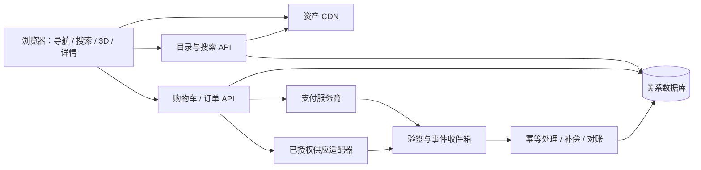

# 实现架构与功能映射

**静态发布补充（2026-10-15）**：用户已要求分别提供线上预览，因此本轮Slides与设计材料的静态发布已获授权；文中应用开发、真实交易与应用部署的限制继续适用。发布完成须以实际可访问的URL核验为准。

更新日期：2026-10-15。状态：产品需求到实现方式的技术草案，不是已实现功能清单。

本文件对齐产品模块 F01～F09；架构子模块使用 ARC-F01～ARC-F22，避免与产品编号混淆。
用户已要求完善产品、信息架构、实现方案、设计探索和静态 HTML Slides；这些授权没有解除网站应用编码限制。
当前没有已批准技术栈、已验证服饰 GLB、实际支付或供货接入；下列方案均须按相应阶段门验证。

## 一、体验要求与事实边界

- 首页采用浅弧形立体展示，中央衣橱最大且正对用户，两侧相邻衣橱部分露出。
- 左右切换改变中央对象；保留衣橱预览、明星头像、姓名、风格介绍与进入按钮。
- 视觉方向为暗色背景、玻璃卡片、投影、环境光和有层次的复杂光影。
- 手机支持手指切换和点击；进入衣橱前提醒横握，旋转后正确适配。
- 选中服饰后，以射灯和镜头聚焦中央舞台，右侧浮现半透明模糊玻璃信息卡。
- 服饰本身需要完整三维模型，可观察正面、侧面和背面；平面图片旋转不能算完成。
- 统一搜索、完整导航、详情维度、站内购买和后台供货整合属于本轮产品方案研究范围。
- 保留竖屏入口、首页先用渲染海报、具体技术栈和交易模式仍为建议，不是已确认实施决定。
- miniroom.5title.com 尚未完成实际体验，不依据未观察到的画面声称已达到或超过参考。
- 最新讨论扩大了产品研究范围，没有自动获得明星合作、素材权利、支付资格或编码批准。

## 二、总体建议与技术候选

一套目录同时驱动首页、搜索、普通列表、3D 场景和详情，避免各页面维护互相冲突的商品事实。
普通目录和文字详情承担检索、分享、可访问性与异常恢复；3D 承担空间体验和真实旋转观察。
交易属于独立业务域，由服务端与已授权供货渠道交互，浏览器不直接调用供应或支付密钥接口。

| 决策 | 推荐方向 | 替代方案与选择条件 | 状态 |
|---|---|---|---|
| 前端 | React + TypeScript 作为候选，普通 UI 与 3D 分层 | 以团队技能和已批准路线为准，避免同时引入多个框架 | 待批准 |
| Web 渲染 | 目录与详情输出可索引 HTML，3D 按需载入 | Next.js 或站点加独立 API 均可；按 SEO、部署和团队能力选择 | 待选型 |
| 3D 引擎 | React Three Fiber / Three.js 优先比较复杂交互 | Spline 比较制作、导出、事件、触摸、性能、托管和费用约束 | 待同样板验证 |
| 业务 API | 模块化单体，目录与交易分域 | 小规模展示可先用版本化 JSON；真实交易必须服务端校验 | 推荐 |
| 数据 | 关系库管理内容关系、订单快照和资金账目 | PostgreSQL 为候选；不因概念阶段先拆微服务 | 待选型 |
| 搜索 | 受控词表、中文别名、筛选和可解释排序 | 达到实际规模或性能瓶颈再比较专用搜索服务 | 推荐 |
| 资产 | 对象存储、CDN、带版本的清单 | 小型概念图可入文档；原始工程和大模型单独管理 | 推荐 |
| 交易 | 单市场、单币种、单授权供应商先闭环 | 多商家拆单、跨境与多币种作为独立扩展 | 待业务确认 |

不默认增加生成式搜索、向量库、微服务集群或实时布料模拟。
用同一房间、同一真实服饰、同一设备比较技术，记录画质、触摸、加载和维护成本。
两天比赛样板可以先用静态目录与明确模拟交易；不能把它当作已完成正式平台架构。

## 三、功能—实现—验收—依赖矩阵

下表“验收”是后续验证方法，不代表已有测试或已通过结果。

| 子模块 | PRD | 用户价值 | 推荐实现与替代 | 验收重点 | 依赖 |
|---|---|---|---|---|---|
| ARC-F01 浅弧轮播 | F01 | 快速挑选衣橱 | 海报配透视变换；再比较实时 3D 卡片 | 中央最大、两侧可见，滑动与按钮结果一致 | 预览、交互原型 |
| ARC-F02 身份信息区 | F01 | 识别人物及风格 | 头像、姓名、简介随对象同步，文字保持正面 | 图片与文案不串位，长姓名不遮按钮 | 内容及头像来源 |
| ARC-F03 响应式/方向 | F01/F04/F09 | 手机自然进入空间 | 按可用尺寸布局，横屏提示后恢复选择 | 旋转不丢状态，宽屏不误提示 | 设备矩阵、方向决策 |
| ARC-F04 全局导航 | F02 | 知道位置并找到内容 | 语义导航、目录路由、明确返回 | 深链接可返回列表，键盘可达 | 信息架构 |
| ARC-F05 分类筛选 | F02/F03 | 按风格、品牌、类别缩小范围 | 受控分类和组合筛选 | 同组 OR、跨组 AND，数量与结果一致 | 标签体系 |
| ARC-F06 统一搜索 | F03 | 直接搜索人物和服饰 | 名称归一化、别名、关键词索引 | 标准名/别名命中，空结果可恢复 | 词表与检索集 |
| ARC-F07 搜索建议 | F03/F08 | 减少输入与歧义 | 按实体类型展示建议，人工维护别名 | 同名人物/品牌可区分，不编造匹配 | 内容运营 |
| ARC-F08 房间与镜头 | F04 | 从预览连续进入空间 | 清单、镜头预设、受控过渡 | 取消、返回、重复进入正常 | 房间资产与锚点 |
| ARC-F09 聚光舞台 | F04 | 聚焦服饰且保留空间关系 | 选择状态驱动灯光、镜头和面板 | 选择/取消/切换可恢复原位置 | 模型、灯光样板 |
| ARC-F10 真实 3D 观察 | F04/F05 | 看正、侧、背面与纹理 | 受控旋转、缩放和复位 | 无假背面、无明显穿模，操作可理解 | 完整模型及材质 |
| ARC-F11 详情 | F05 | 理解服饰、来源和购买条件 | 空间面板与独立页共用结构化内容 | 缺字段诚实展示，详情可分享 | 详情字段与证据 |
| ARC-F12 变体与报价 | F05/F06 | 选对颜色、尺码和购买对象 | Item、Variant、Offer 独立，模型明确映射 | 不静默换模型/商品，不把示意当实物 | SKU/资产映射 |
| ARC-F13 购物车与报价 | F06 | 知道实际总价和可售条件 | 服务端重算库存、税费、运费与时效 | 变化重新确认，失效商品可移除 | 市场及供应能力 |
| ARC-F14 结账支付 | F06 | 连续完成付款 | 安全支付组件或托管流程，订单可恢复 | 不重复扣款，认证返回可查证 | 主体与支付资格 |
| ARC-F15 供货编排 | F06/F07 | 付款后可真实履约 | 单供应适配器、查询、补偿、对账 | 超时/拒单/部分供货有明确结果 | 供货及售后协议 |
| ARC-F16 订单身份 | F07 | 找回订单和查进度 | 游客安全访问为候选，账号按需扩展 | 无法访问他人订单，支付回跳可恢复 | 身份及通知策略 |
| ARC-F17 退款支持 | F07 | 异常有处理路径 | 退款独立记录、余额校验、人工入口 | 部分退款及重复回调正确 | 规则及运营责任 |
| ARC-F18 内容运营 | F08 | 持续得到准确信息 | 草稿、预览、发布、下架及版本 | 草稿不公开，下架同步检索 | 编辑与发布权限 |
| ARC-F19 资产运营 | F08 | 获得一致视觉质量 | 资产检查、质量档、清单和回滚 | 错误资产可定位和撤回 | 制作与来源记录 |
| ARC-F20 分享恢复 | F09 | 返回或刷新继续浏览 | URL 存对象与筛选，会话存有限视角 | 刷新/后退/旋转不丢关键状态 | 稳定实体 ID |
| ARC-F21 降级/无障碍 | F09 | 异常时仍能找内容操作 | 同目录图片文字视图、键盘、减少动态 | WebGL 失败不困住用户，读屏可理解 | 替代素材与语义 UI |
| ARC-F22 监测与发布 | F08/F09 | 异常可定位、版本可撤回 | 事件、错误、性能、交易对账分域 | 去重与请求关联，不记敏感支付资料 | 指标及环境策略 |

## 四、系统边界

- 浏览器处理展示、输入与 UI 恢复，服务端确认价格、库存、归属与支付结果。
- 目录处理公开内容、发布状态、词表和资产引用，不保存银行卡资料。
- 交易处理报价、订单快照、支付账目、供应请求和退款，不依赖前端成功提示。
- 供应适配器隔离外部字段和状态；外部接口变化不直接扩散到页面。
- 任务可与 API 同库部署，但事件必须持久化，不能只依赖进程内计时器。
- 内容下架同步索引；历史订单保留当时商品与价格快照，不被当前目录覆盖。

## 五、概念数据模型与不变量

| 实体 | 主要内容 | 约束 |
|---|---|---|
| Person | 稳定 ID、姓名、别名、头像、简介 | 名称不是主键，来源与授权独立记录 |
| Closet | 人物、风格、呈现性质、预览、场景版本、发布态 | 真实复刻/授权创作/编辑策展必须区分 |
| Item | 名称、类别、品牌、材质、故事、场合、衣橱关系 | 展示对象不自动等于可售商品 |
| Variant | 颜色、尺码、尺寸表、规格、唯一实物编号 | 唯一件独立库存，不混用 SKU 和展示 ID |
| Offer | 变体、供应方、市场、币种、价格、可售状态、有效期 | 一个变体可多报价；只展示实际可用报价 |
| AssetVersion | 来源类型、权利记录、文件版本、质量档、校验值 | 扫描、参考重建、视觉示意分开标识 |
| AssetBinding | Item/Variant 与模型、材质、海报、锚点关系 | 与当前颜色/尺码不符时明示 |
| TaxonomyTerm | 风格、类别、标签、父级、别名 | 修改后保留兼容或重定向 |
| RightsRecord | 主体、范围、期限、证据引用、状态 | 私密证明不直接放入公开资料 |
| Quote | 行项目、费用组成、币种、配送范围、版本、到期 | 过期重算，前端金额不可信 |
| Order | 身份关联、商品/金额快照、版本、业务状态 | 历史事实不随目录更新而改变 |
| PaymentAttempt | 外部引用、金额、币种、幂等键、状态 | 可多次尝试，但成功金额不可重复入账 |
| Fulfillment | 供应引用、分配数量、物流、状态 | 供应失败不等于支付失败 |
| Refund | 行项目、金额、原因、外部引用、状态 | 累计不超过实际可退余额 |
| EventInbox/Outbox | 来源、事件 ID、结果、重试与审计 | 唯一键去重，可追踪可重放 |

“明星拥有/穿过”“品牌同款”“相似风格”是不同关系，不能只靠文案模糊区分。
空间真实性必须有对应证据，精美渲染不能替代授权、实物来源或真实住宅依据。
没有核实 SKU 和授权报价时可展示内容，不给让用户误以为能买到原件的入口。
3D 可使用明示的代表尺码，不要求每个可售尺码均制作独立几何；只同步已制作并核验的外观变体。
预览尺码和展示方式应说明；可旋转模型不是试穿、合身或真实上身效果保证。
金额使用币种与最小货币单位整数，不以浮点计算应付额；税费运费口径写入快照。
本地库存锁不等于供应商预留；未得到外部确认不能声称已锁定唯一实物。
地址、订单访问令牌和支付引用与公开内容分开保存。

## 六、概念接口与异步契约

以下表达接口责任，最终路径和字段随技术选型确认，不代表已存在端点。

| 契约 | 重点输入/输出 | 一致性与异常 |
|---|---|---|
| GET /home | 发布衣橱、排序、海报与身份摘要 | 不返回全部模型，可按内容版本缓存 |
| GET /search | 查询、范围、筛选、排序、游标及分组结果 | 空查询/无结果区分，遵循内容可见性 |
| GET /closets/{id} | 内容版本、清单、镜头、单品引用 | 缺资源可定位，下架有可用返回路径 |
| GET /items/{id} | 详情、资产映射、变体、报价、购买关系 | 注明报价时效，缺模型不伪装可旋转 |
| POST /quotes | 报价项、变体、数量、配送范围 | 服务端重算费用/库存，变化需确认 |
| POST /orders | 报价版本、联系配送信息、幂等键 | 过期不下单，重试返回相同命令结果 |
| POST /payment-sessions | 订单、允许回跳目标、幂等键 | 校验归属金额，密钥不传前端 |
| POST /webhooks/{source} | 原始事件、签名、时间、外部事件 ID | 验签持久化，处理重复及乱序 |
| GET /orders/{id} | 授权后的订单/支付/供应/退款摘要 | 不信任 URL 的成功标记 |
| POST /orders/{id}/cancel | 原因、版本、幂等键 | 与发货竞态时返回真实允许操作 |
| POST /refund-requests | 行项目、金额/数量、原因、幂等键 | 区分申请审核和实际退款结果 |

错误至少区分未找到、已下架、加载失败、报价过期、缺货、未授权和暂不可用。
幂等键限定操作与身份并绑定请求摘要；同键不同内容拒绝执行，不覆盖原命令。
可重试错误有请求关联 ID，不回显外部密钥、个人资料或供应商内部异常。
列表稳定排序；模型、锚点与材质引用同一兼容版本，避免半更新状态。

## 七、搜索与导航规则

1. 归一化 Unicode、空白和大小写；简繁及标点差异依维护词表验证。
2. 艺名、中文译名、英文/拼音别名和品牌别名映射实体 ID，不自由猜测关系。
3. 结果覆盖人物、衣橱和服饰，显示类型，避免同名歧义。
4. 标准名/别名精确命中优先，其次标题、品牌/类别/标签、简介，规则可解释。
5. 同筛选组 OR，不同组 AND；筛选数量与结果使用相同权限和发布态。
6. 价格/库存筛选只作用于可售报价；欣赏内容不伪造零价格。
7. 价格排序先固定市场和币种，不混比不同费用口径。
8. 无结果保留查询，提供移除条件、相关别名和目录入口，不生成不存在的商品。
9. 查询、筛选、排序写 URL；返回时恢复条件和滚动位置。
10. 发布、词表变更与下架触发索引更新，详情仍校验当前可见性。
11. 人工查询集覆盖标准名、别名、品牌、类别、组合筛选、错字与无结果。
12. 小数据先验证简单索引；真实召回或性能瓶颈出现后才引入搜索服务。

全局导航建议覆盖首页、探索/目录、搜索，以及交易启用后的购物车和订单。
详情有独立 URL，不把分享、内容发现或订单入口锁在单一 3D 画布中。

## 八、3D、灯光与资产管线

### 8.1 运行时

- 首页先比较高质量海报配浅弧变换；用户尚未批准用图片取代实时预览的具体实现。
- 只加载当前进入衣橱的资源，邻居最多预取小海报，不同时加载全部房间。
- 房间与精细单品分层，聚焦时按需加载，有可取消且准确的进度反馈。
- 环境贴图/烘焙光照与少量实时关键灯组合为候选，按手机实测调整。
- 聚光强调形体，补光和轮廓光保留深色布料、透明与金属细节，避免过曝改变色感。
- 灯保持空间方向，服饰转动时高光自然变化；背景压暗但保留环境关系。
- 玻璃模糊面积与实时阴影数量受预算约束，文字始终有足够底色和对比度。
- 服饰旋转与房间镜头模式分开，避免同一拖动操纵两者；复位和退出明确。
- 减少动态时关闭自动旋转和大幅镜头运动，保留选择、观察和返回。
- 离场释放不用的纹理/模型/材质，后台暂停非必要渲染；回前台恢复当前对象。
- WebGL 上下文丢失提供恢复/普通视图；模糊不支持时保留可读界面。
- 图片文字兜底是兼容措施，不计入真实 3D 完成率。

### 8.2 从制作到交付

1. 收集来源、使用范围、尺寸、身份和参考，标注扫描/重建/示意。
2. 制作母版，先确认人体/衣架展示方式、风格和真实感标准。
3. 核验拓扑、UV、PBR、真实比例、原点、轴向、相机和灯光锚点。
4. 检查正反、领口、腋下、边缘、透明双面、褶皱和穿插，不只验正面截图。
5. 生成质量档、海报和缩略图，压缩几何/纹理但保留可见细节。
6. 验证目标浏览器的 GLB/glTF、纹理和解码器支持，保持完整性和 TLS 校验。
7. 清单记录体积、版本、校验值、变体映射、权利引用和制作来源。
8. 实机验证后发布版本，可撤回；不静默覆盖已发布资产。
9. 大模型和原始工程单独存储，仓库保存必要清单、说明与小型设计材料。

手机不依赖锁屏方向或全屏 API；这些能力受平台、浏览器和用户手势限制。
方向变化保存衣橱、单品、变体和视角；是否允许继续竖屏仍需产品决定。

## 九、交易边界与独立状态

### 9.1 站内体验与实际责任

站内购买是优先探索方向，必须明确销售/收款主体、市场币种、发货、税费和退换责任。
供应须来自授权 API、合作库存或受许可渠道，任意电商抓取不构成可履约库存。
可以统一品牌与交互，不能隐去用户决策或法规要求的销售/履约信息。
银行或支付认证可能离开当前页面，返回后恢复订单，不承诺完全无第三方环节。
演示购买必须醒目标识模拟，不收真实银行卡、地址，不冒充成功收款或实际库存。

### 9.2 分域状态

| 状态域 | 示例 | 原则 |
|---|---|---|
| Checkout/Quote | 已报价、校验中、待付款、过期、完成 | 不等于已支付订单，过期重算 |
| Order | 创建、确认、履约中、完成、取消、需人工 | 业务摘要，不替代资金账目 |
| Payment | 待付、已授权、已扣款、失败、授权撤销 | 每次尝试独立，退款金额由退款记录汇总 |
| Supply | 未请求、预留、接受、部分接受、拒绝、未知 | 超时不能直接当拒绝后重复下单 |
| Fulfillment | 待发、部分发、已发、送达、异常 | 包裹和订单可一对多 |
| Refund | 申请、处理中、成功、失败、需人工 | 申请通过不等于资金到账 |

### 9.3 推荐流程与补偿

- 服务端校验 SKU、地区、库存和总价，创建时效报价，用户确认变化后创建订单。
- 支付与供应分别使用幂等键和外部引用，重复点击不能重复扣款或下供应单。
- 支持预授权且协议允许时比较“授权—供应确认—扣款”；否则先决定先扣款的拒单责任。
- 支付成功但供应失败，追踪撤销授权或退款，不静默换货、换尺码或换供应条款。
- 供应超时先按引用查询，不在结果未知时重复创建外部订单。
- 回调验签、去重、持久化，乱序事件用版本、查询和对账收敛。
- 外部已成功但请求失败时幂等重试返回原结果，刷新页面不重新扣款。
- 部分退款按行和金额核余额，失败不显示已到账，悬挂状态进入对账与人工队列。
- 外链可作为明确标识的备选路径，不能用跳转测试冒充站内交易闭环。

## 十、恢复、无障碍、安全与观测

- URL 存实体、查询、筛选和排序，不存地址、个人资料或支付令牌。
- 会话存卡片、滚动和有限视角，连续旋转不逐次污染历史；刷新先检查资产版本。
- 手机纵向滚动与横向切换分清，滑动不能误触进入；旋转不重建订单。
- 核心操作提供键盘/按钮替代，轮播位置和信息变化能被读屏理解。
- 加载、取消、失败、重试、空内容、不可购买分别设计，不用无限转圈代替。
- 订单访问验证归属，不能只凭可猜 ID；编辑、发布、退款、管理分权限并有审计。
- 密钥服务端环境绑定，回调验签防重放；不在日志记录地址、卡号、访问令牌。
- 公开目录可缓存，订单/报价/地址/账号响应不进入公共共享 CDN。
- 履约方只获得所需配送资料，不共享额外浏览记录；留存按确定的数据策略执行。
- 记录搜索有结果率、进入成功、单品打开、加载/帧时/降级和交易对账指标。
- 明确曝光/点击/完成触发点并去重，不把预加载算进入；请求 ID 串联异常。
- 测试与真实支付隔离，网页展示也不能承诺公开模型绝对无法被提取。

## 十一、设备验证与性能预算（待验证目标）

这些数字是工程提案，不是现状、已通过结果或全设备承诺；画质与性能必须共同评审。

| 项目 | 首轮建议 | 条件与记录 |
|---|---|---|
| 普通首页 | LCP ≤ 2.5 秒、INP ≤ 200ms、CLS ≤ 0.1 | 实验室记录方法，上线后才可看真实用户 p75 |
| 首批首页资源 | 压缩后争取 ≤ 2 MB | 不含尚未进入房间，预取另计且可取消 |
| 房间首次可操作 | 10 Mbps / RTT 100ms 下争取 ≤ 8 秒 | 冷缓存、中档设备、固定房间与质量档 |
| 移动房间资源 | 首轮争取 ≤ 8 MB | 精细单品另按需加载，画质不足重新评估 |
| 聚焦旋转 | 移动目标 30 FPS，桌面再探索 60 FPS | 同时报 p95 帧时、卡顿，不只报平均 |
| 稳定性 | 5 分钟、20 次切换无崩溃为样板目标 | 记录资源释放和温度表现，不臆测 GPU 内存 |
| 视觉 | 正侧背、材质、阴影、玻璃文字经评审 | 同场景同视角，不用概念图替代实机 |

每项记录设备/系统/浏览器、网络、冷热缓存、画质档、资产版本和实际通过/未通过/未测试。
矩阵至少选具体 iPhone Safari、中档 Android Chrome、macOS Safari/Chrome、Windows Chrome。
覆盖横竖屏、弱网断网、后台恢复、低电量与 WebGL 不可用；深色和反射/透明样板优先。
尚未实际体验参考站前，不宣称“已超过参考”；跑分也不能单独证明真实感。

## 十二、分期与决策依赖

| 阶段 | 交付 | 下一阶段门槛 |
|---|---|---|
| A 本轮 | 文档、信息架构、概念与静态 HTML Slides | 用户审阅，核心依赖与责任明确 |
| B 另行授权后 | 一房间、一真实服饰比较技术/设备 | 画质、旋转、玻璃卡、手机和恢复证据 |
| C 浏览纵向切片 | 首页→搜索/目录→空间→详情→返回/分享 | F01～F05/F09 闭环、内容可追溯 |
| D 交易试点 | 单市场单供应：报价→支付→供货→订单→退款 | 主体/授权/售后就绪，沙箱与真实试点分别验收 |
| E 扩展 | 更多内容、搜索、供应渠道 | 成本、运营和稳定性证据支持 |

| 依赖 | 要关闭的问题 | 影响 |
|---|---|---|
| DEP01 技术 | 同样板比较引擎、前端与部署方式 | F01/F04/F05/F09 |
| DEP02 内容资产 | 人物/服饰、来源、授权、制作方式 | F01/F03/F04/F05/F08 |
| DEP03 词表 | 类别、风格、标签、别名与商品关系 | F02/F03/F05/F08 |
| DEP04 交易 | 市场币种、销售收款、供应、售后 | F06/F07 |
| DEP05 设备画质 | 首要机型、横屏强制与否、降级标准 | F01/F04/F05/F09 |
| DEP06 集成 | 沙箱、正式资格、通知、安全绑定 | F06/F07/F08 |
| DEP07 运营 | 内容/资产/支持/监控与回滚责任 | F08/F09 |

后续任务须引用模块 ID、具体资产、证据与依赖，不只按概念截图还原外观。
两天比赛缩减方案另见[两天冲刺与团队](两天冲刺与团队.md)；不自动替代正式产品范围。
需求与状态以[需求说明](需求说明.md)及最新用户指令为准；本文件不证明网站、模型或交易已实现。
